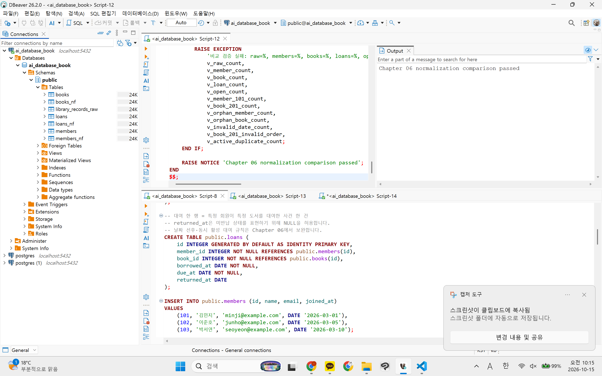
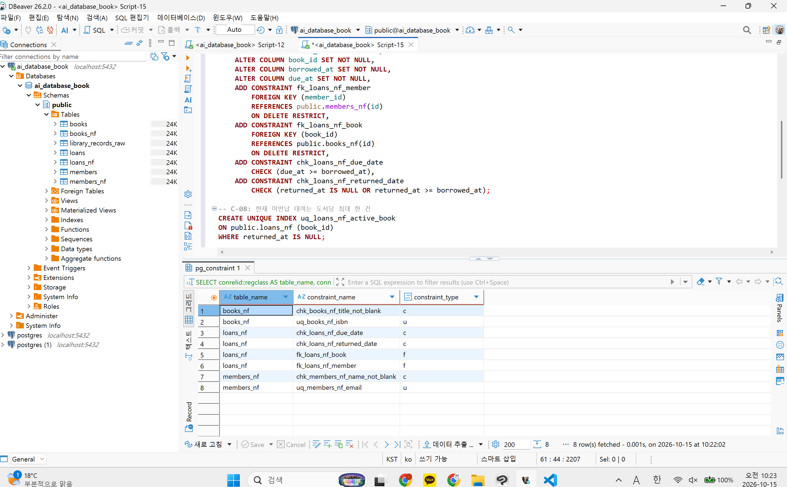
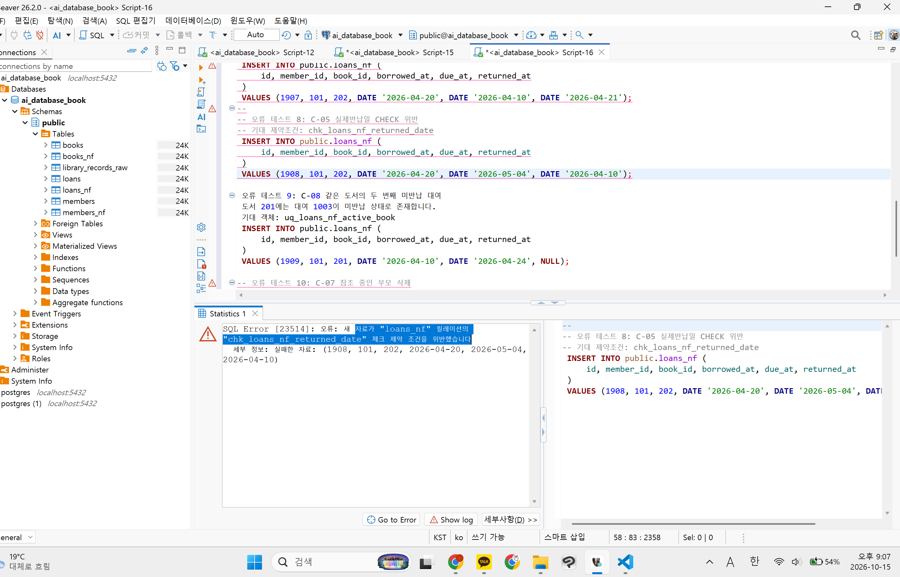
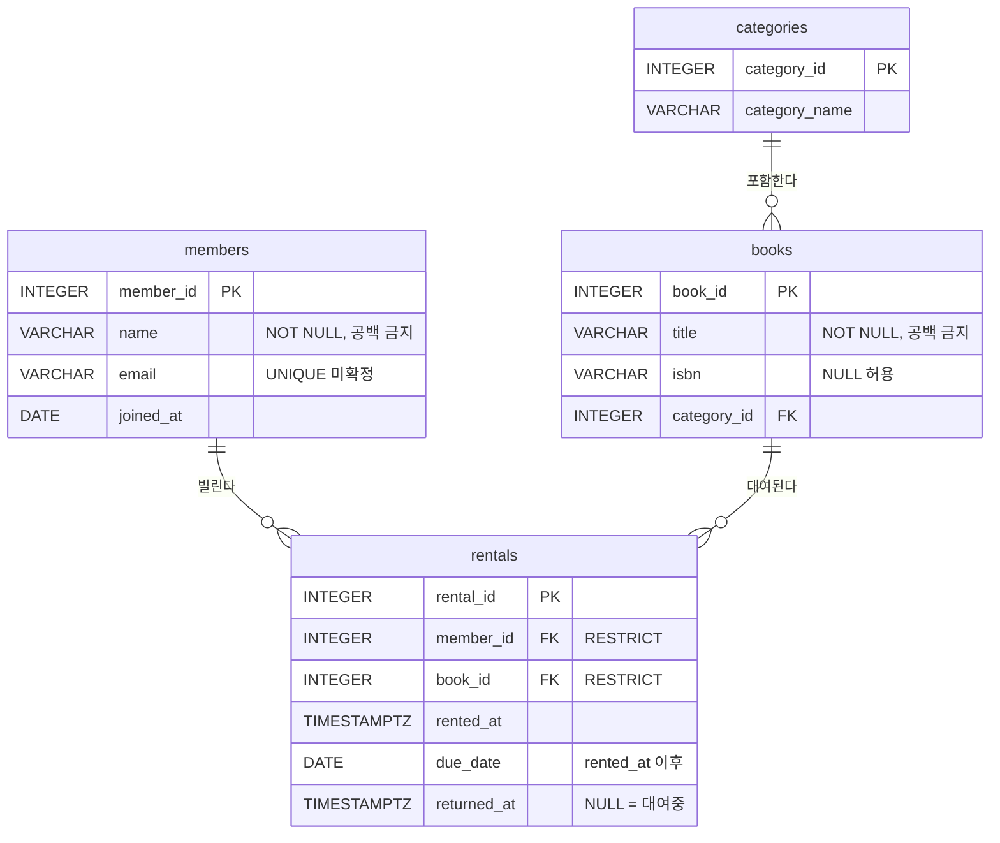

# Chapter 06 확장 실습 답안 템플릿

> **과제:** 정규화와 데이터 무결성으로 좋은 테이블 만들기  
> **사용 방법:** 이 파일을 내려받아 본인의 GitHub 저장소에 `chapter06_answer.md`라는 이름으로 저장한 뒤 실습하면서 바로 작성합니다.  
> **제출 방법:** LMS에는 파일을 직접 업로드하지 않고, **본인 GitHub 저장소의 `chapter06_answer.md` 파일 URL**을 제출합니다.

---

## 제출 전 주의

이 파일과 캡처 화면에는 실제 비밀번호, 전체 DB 접속 URL, API Key, 개인정보를 기록하지 않습니다.

```text
GitHub 계정 또는 별칭:0524youna
과제 작성일:261014
사용한 AI 도구:claude
```

---

# 1. 실습 환경과 시작 상태 확인

다음을 실행합니다.

```sql
SELECT current_database();
SELECT current_user;
SELECT current_schema();
SHOW search_path;
SHOW transaction_read_only;
```
| 확인 항목 | 실제 결과 | 의미 |
| --- | --- | --- |
| `current_database()` | `ai_database_book` | 지금 접속한 DB |
| `current_user` | `postgres` | postgres 계정으로 접속 중임 |
| `current_schema()` | `public` | 스키마 생략 시 public에 테이블이 만들어짐 |
| `search_path` | `public, "$user"` | 테이블 이름만 쓰면 public부터 찾음 |
| `transaction_read_only` | `off` | 읽기 전용이 아니라 CRUD 실행 가능 |

- [x] 현재 DB가 `ai_database_book`이다.
- [x] 변경 가능한 연결인지 확인했다.
- [x] Auto-commit 상태를 확인했다.
- [x] Chapter 06 번호형 SQL 파일을 사용한다.

---

# 2. 정규화 전 큰 테이블의 문제 찾기

본문의 `library_records_raw` 구조를 기준으로 생각합니다.

```text
library_records_raw 한 행
→ 대여 사건 한 건이지만 회원·도서의 현재 사실까지 함께 저장된 구조
```

## 2-1. 위험한 중복과 의미 있는 반복 구분

| 반복되는 값/상황 | 위험한 중복 / 의미 있는 반복 | 판단 이유 |
| --- | --- | --- |
| 회원 이메일이 여러 대여 행에 반복 | 위험한 중복 | 같은 현재 사실을 여러 곳에서 관리함. 수정 시 불일치 위험. |
| 도서 제목이 여러 대여 행에 반복 | 위험한 중복 | 제목은 도서의 현재 사실. 대여 행마다 복사되면 한 곳만 고쳐도 값이 어긋남. |
| `loans_nf.member_id = 101` 반복 | 의미 있는 반복 | 한 회원이 여러 대여 사건을 가진다는 정상적인 반복. |
| 사건 당시 가격 같은 이력값 반복 | 의미 있는 반복 | 과거 시점의 사실을 보존하는 이력값. |

## 2-2. 이상 현상 설명

### 삽입 이상

```text
아직 한 번도 대여되지 않은 새 도서를 등록하려 할 때 생기는 문제: 회원과 대여일이 없으면 행을 넣기 어려움. 도서만 따로 등록할 수 없음.
```

### 수정 이상

```text
회원 이메일이 변경될 때 생기는 문제: 여러 대여 행을 모두 수정해야 함. 하나라도 빠지면 값이 불일치함.
```

### 삭제 이상

```text
마지막 대여 기록을 삭제할 때 생길 수 있는 문제: 그 행에만 남아 있던 회원·도서 정보도 함께 사라짐.
```

### 왜 이것이 SQL 문법 문제가 아니라 구조 문제인가요?

```text
수명과 변경 이유가 다른 사실을 한 테이블에 함께 저장했기 때문임. SQL은 정상 실행되지만 데이터의 의미가 깨지는 구조 문제임.
```

---

# 3. 1NF·2NF·3NF 핵심 질문 복습

정규형 이름만 외우지 말고 **왜 분리하는지** 설명합니다.

## 3-1. 제1정규형(1NF)

```text
한 셀에 쉼표로 여러 독립 값을 넣거나 book1/book2/book3처럼 반복 열을 만들면 왜 문제가 되는가: 특정 값 검색·집계·수정이 어렵고, 반복 열은 개수 제한이 생김. 한 셀에는 독립적인 값 하나만 넣고, 반복 열 대신 같은 구조의 행을 추가해야 함.
```

내 서비스에서 비슷한 위험이 있는 예:

```text
영화 예매 서비스에서 한 예매에 좌석 여러 개를 고를 수 있음.
Reservations 한 행에 seats = 'H5,H6,H7'로 넣거나 seat1/seat2/seat3 열을 만들면,
- 좌석 하나만 취소하기 어려움
- 같은 회차 좌석의 중복 예매를 DB가 막을 수 없음
→ ReservationSeats에 좌석 한 개당 한 행으로 저장함.
영화의 장르도 Movies에 '액션,SF'로 넣지 않고 MovieGenres 행으로 분리함.
```

## 3-2. 제2정규형(2NF)

다음 관계를 설명합니다.

```text
(student_id, course_id) → grade
student_id → student_name
course_id → course_name
```

```text
복합키 전체가 아니라 일부에만 의존하는 열을 분리해야 하는 이유: student_name은 student_id만으로 정해짐. 수강 행마다 이름이 반복 저장되어 수정 이상이 생김. 학생·과목 정보는 각자의 테이블로 분리하고, 수강 테이블에는 grade만 남김.
```

## 3-3. 제3정규형(3NF)

```text
member_id → zip_code
zip_code → city
```

```text
일반 열이 다른 일반 열을 결정하는 구조를 검토해야 하는 이유: city는 member_id가 아니라 zip_code에 따라 정해짐. 우편번호의 도시 정보가 바뀌면 그 우편번호를 가진 회원 행을 모두 고쳐야 하고, 일부만 고치면 불일치가 생김.
```

### 정규화는 값이 반복되기만 하면 무조건 분리하는 것인가요?

```text
값이 반복된다는 이유만으로 테이블을 분리하지 않습니다. 일관된 결정 규칙과 독립적으로 관리할 필요가 있는지 확인해야 합니다.
```

---

# 4. 각 열의 '사실의 주인' 찾기

| 열 | 어떤 사실을 설명하는가 | 주인 테이블 | 이유 |
| --- | --- | --- | --- |
| `member_name` | 회원 정보 - 이름 | member | 대여와 상관없이 회원에게 속한 현재 사실 |
| `member_email` | 회원 정보 - 이메일 | member | 회원의 현재 연락처. 한 곳에서만 관리해야 함 |
| `book_title` | 도서 정보 - 제목 | book | 대여와 상관없이 도서에 속한 사실 |
| `author` | 도서 정보 - 저자 | book | 도서에 속한 사실 |
| `borrowed_at` | 대여 정보 - 대여일 | loan | 대여 사건마다 다른 값 |
| `due_at` | 대여 정보 - 반납 기한 | loan | 대여 사건마다 정해지는 값 |
| `returned_at` | 대여 정보 - 반납일 | loan | 대여 사건의 결과. 미반납이면 NULL |
| `member_id` | 회원 식별자 | member | 회원을 식별하는 키. loan에서는 참조용 FK |
| `book_id` | 도서 식별자 | book | 도서를 식별하는 키. loan에서는 참조용 FK |

정규화 후 한 행의 의미:

```text
members_nf 한 행 = 회원 한 명
books_nf 한 행 = 대여 대상으로 관리하는 도서 항목 한 건
loans_nf 한 행 = 특정 회원이 특정 도서를 대여한 사건 한 건
```

### 현재 사실과 사건 당시 이력을 구분하는 기준

```text
값이 바뀌었을 때 과거 기록도 같이 바뀌어야 하는지로 구분함.
- 같이 바뀌어야 함 → 현재 사실. 주인 테이블 한 곳에만 저장. 
- 당시 값이 그대로 남아야 함 → 사건 당시 이력. 사건 테이블에 저장. 
```
---

# 5. PostgreSQL로 정규화 전·후 구조 재현

Public 저장소의 다음 파일을 순서대로 사용합니다.

```text
code/chapter06/01_normalization_schema.sql
code/chapter06/02_normalization_seed.sql
code/chapter06/03_normalization_compare.sql
```

## 5-1. `01_normalization_schema.sql`

실행 전 예상:

```text
생성될 테이블 수: 3
각 테이블 예상 행 수: 0
```

실행 후:

```text
실제로 생성된 테이블: 4 (정규화 전 library_records_raw + members_nf, books_nf, loans_nf)
각 테이블 실제 행 수: 0
```

예상(3)과 다른 이유: 정규화 후 3개만 생각하고, 비교용 정규화 전 raw 테이블을 빠뜨림.

## 5-2. `02_normalization_seed.sql`

실행 전 예상 기준:

```text
raw = 3
members = 2
books = 2
loans = 3
미반납 = 2
회원 101 대여 = 2
도서 201 대여 = 2
```

실제 결과:

```text
raw: 3
members: 2
books: 2
loans: 3
미반납: 2
회원 101 대여: 2
도서 201 대여: 2
```

예상과 다른 값이 있다면 이유:

```text
없음. 모든 값이 예상과 같음.
```

## 5-3. `03_normalization_compare.sql`

```text
검증 메시지: Chapter 06 normalization comparison passed

PASS / FAIL: PASS
```

다음 항목을 확인합니다.

```text
회원 고아 참조: 0
도서 고아 참조: 0
날짜 순서 오류: 0
활성 대여 중복: 0
```

### 정규화 후에도 JOIN으로 원래 업무 정보를 다시 볼 수 있는 이유

```text
loans_nf가 member_id, book_id로 회원·도서를 참조하기 때문임.
이 키로 JOIN하면 원래 raw 테이블의 한 행을 그대로 복원할 수 있음.
고아 참조가 0이라 빠지는 행도 없음. 분리했지만 업무 의미는 잃지 않음.
```

### 증거 화면

권장 경로:

```text
assignments/chapter06/images/step05_normalization.png
```



---

# 6. Chapter 06에서 확정한 C-01~C-08 정책 해석

| ID | 확정 규칙 | 구현 방법 | 왜 필요한가 | Chapter 05에서는 왜 미확정이었나 |
| --- | --- | --- | --- | --- |
| C-01 | 이메일 문자열 중복 금지 | `UNIQUE` | 한 이메일로 회원이 둘 생기는 것을 막음 | 이메일 고유 여부와 대소문자 처리가 정해지지 않았음 |
| C-02 | ISBN 필수·중복 금지 | `NOT NULL + UNIQUE` | ISBN으로 도서를 확실히 식별하기 위함 | ISBN 없는 도서, 같은 ISBN 복본 허용 여부가 미정이었음 |
| C-03 | 이름·제목 공백 금지 | `CHECK` | 빈 문자열은 NOT NULL로 못 막음 | 공백만 있는 값을 막을지 기준이 없었음 |
| C-04 | `due_at >= borrowed_at` | `CHECK` | 반납 기한이 대여일보다 빠른 오류를 막음 | 당일 반납 기한을 허용할지 정해지지 않았음 |
| C-05 | `returned_at`은 NULL 또는 대여일 이상 | `CHECK` | 미반납은 허용하고, 대여 전 반납은 막음 | 반납 상태를 NULL로 표현할지 status로 표현할지 미정이었음 |
| C-06 | 존재하는 회원·도서만 참조 | `FOREIGN KEY` | 고아 대여 기록을 막음 | 테이블 분리 구조가 아직 확정되지 않았음 |
| C-07 | 대여 이력이 있는 부모 삭제 금지 | `ON DELETE RESTRICT` | 회원·도서 삭제로 대여 이력이 사라지는 것을 막음 | 탈퇴 회원·폐기 도서 처리 방식이 정해지지 않았음 |
| C-08 | 도서당 미반납 대여 최대 한 건 | 부분 고유 인덱스 | 같은 책이 동시에 두 명에게 대여되는 것을 막음 | 실물 복본을 어떻게 구분할지 정해지지 않았음 |

### 확정되지 않은 정책을 제약조건으로 먼저 만들면 위험한 이유

```text
요구사항에 없는 규칙을 설계자가 임의로 정하게 됨.
정상 데이터까지 거부될 수 있음. (예: ISBN UNIQUE → 같은 ISBN 복본 등록 불가)
나중에 정책이 바뀌면 제약조건과 이미 저장된 데이터를 함께 고쳐야 함.
```

---

# 7. 기존 데이터 검사 후 무결성 규칙 적용

실행 파일:

```text
code/chapter06/04_add_integrity_rules.sql
```

## 7-1. 규칙을 추가하기 전에 기존 데이터를 먼저 검사해야 하는 이유

```text
기존 데이터가 이미 새 규칙을 위반하고 있을 수 있기 때문임.
위반 데이터가 있으면 ALTER TABLE이 실패함.
먼저 찾아서 정리한 뒤 규칙을 추가해야 함.
```

## 7-2. 실행 결과

```text
명명된 제약조건 개수: 8
NOT NULL 적용 열 개수: 10
부분 고유 인덱스 존재 여부: 있음
COMMIT 성공 여부: 성공
```

### 메타데이터를 확인하는 이유

```text
SQL이 오류 없이 끝났다고 규칙이 적용된 것은 아님.
시스템 카탈로그에서 제약조건·인덱스가 실제로 있는지 직접 확인해야 함.
이름을 붙인 제약조건은 나중에 오류 메시지에서 어떤 규칙인지 바로 알 수 있음.
```

### 증거 화면

권장 경로:

```text
assignments/chapter06/images/step07_constraints.png
```



---

# 8. 정상·경계·실패 테스트

실행 파일:

```text
code/chapter06/05_integrity_tests.sql
```

> **중요:** 오류 테스트는 한 번에 하나씩 실행하고, 각 테스트가 끝난 뒤 기준 데이터가 유지되는지 확인합니다.

## 8-1. 허용되어야 하는 경계값

최소 3개를 실행·관찰합니다.

| 테스트 | 예상 | 실제 | 왜 허용되어야 하는가 |
| --- | --- | --- | --- |
| `due_at = borrowed_at` | 성공 | 성공 | 규칙이 `>=`라서 같은 날도 허용됨 (당일 반납 기한) |
| `returned_at = borrowed_at` | 성공 | 성공 | 규칙이 `>=`라서 당일 반납도 허용됨 |
| `returned_at = NULL` | 성공 | 성공 | 미반납 대여는 NULL로 표현하기로 함 (C-05) |
| `published_year = NULL` | 성공 | 성공 | 출판연도는 필수값으로 정하지 않았음 |
| 공백이 아닌 한 글자 이름 | 성공 | 성공 | 규칙은 공백만 막음. 길이 제한은 없음 |

## 8-2. 실패해야 하는 오류값

최소 6개를 실행합니다.

| 오류 테스트 | 기대 규칙 | 실제 결과 | 오류 메시지 핵심 | 실패해야 하는 이유 |
| --- | --- | --- | --- | --- |
| 필수값 NULL | `NOT NULL` | 실패 | `members_nf.name`의 NULL 값이 NOT NULL 제약조건을 위반 | 필수 회원 이름은 NULL일 수 없음 |
| ISBN NULL | `NOT NULL` | 실패 | `books_nf.isbn`의 NULL 값이 NOT NULL 제약조건을 위반 | 도서 식별에 필요한 ISBN은 NULL일 수 없음 |
| 이메일 중복 | `UNIQUE` | 실패 | `uq_members_nf_email` 고유 제약조건 위반 | 회원 이메일은 중복될 수 없음 |
| ISBN 중복 | `UNIQUE` | 실패 | 중복 키 값이 `uq_books_nf_isbn` 고유 제약조건을 위반 | 같은 ISBN의 도서를 중복 등록할 수 없음 |
| 공백 이름/제목 | `CHECK` | 실패 | `chk_members_nf_name_not_blank` 체크 제약조건 위반 | 이름/제목은 공백만으로 이루어질 수 없음 |
| 존재하지 않는 회원 | `FOREIGN KEY` | 실패 | `fk_loans_nf_member` 외래 키 제약조건 위반 | 대여는 존재하는 회원을 참조해야 함 |
| 존재하지 않는 도서 | `FOREIGN KEY` | 실패 | `fk_loans_nf_book` 외래 키 제약조건 위반 | 대여는 존재하는 도서를 참조해야 함 |
| 날짜 순서 위반 | `CHECK` | 실패 | 자료가 "loans_nf" 릴레이션의 "chk_loans_nf_returned_date" 체크 제약 조건을 위반했습니다 | 반납일은 대여일보다 빠를 수 없음 |
| 두 번째 미반납 대여 | 부분 고유 인덱스 | 실패 | 중복 키 값이 `uq_loans_nf_active_book` 부분 고유 인덱스를 위반 | 한 도서는 동시에 한 명에게만 대여될 수 있음 (C-08) |
| 참조 중 부모 삭제 | `RESTRICT/FK` | 실패 | "members_nf" 테이블의 자료 갱신, 삭제 작업이 RESTRICT "fk_loans_nf_member" 참조키(foreign key) 제약 조건 - "loans_nf" 테이블 - 을 위반했습니다 | 대여 이력이 참조하는 회원·도서는 삭제할 수 없음 |

## 8-3. 테스트 후 기준 상태 재검증

```text
raw: 3
members: 2
books: 2
loans: 3
미반납: 2
회원 고아 참조: 0
도서 고아 참조: 0
활성 대여 중복: 0
```

### 실패 테스트 후 기준 데이터가 유지되어야 하는 이유

```text
제약조건은 잘못된 변경만 막고, 기존 데이터는 건드리지 않아야 함.
실패한 문장은 반영되지 않으므로 행 수가 그대로여야 정상임.
기준이 바뀌면 다음 테스트 결과를 믿을 수 없음.
```

### 증거 화면

권장 경로:

```text
assignments/chapter06/images/step08_integrity_error.png
```



---

# 9. 정규화와 무결성 제약조건 역할 비교

| 질문 | 나의 설명 |
| --- | --- |
| 정규화가 해결하는 문제 | 같은 사실의 중복 저장과 삽입·수정·삭제 이상 |
| `NOT NULL`이 해결하는 문제 | 필수값이 빠진 행 |
| `UNIQUE`가 해결하는 문제 | 하나여야 하는 값의 중복 (이메일, ISBN) |
| `CHECK`가 해결하는 문제 | 업무상 불가능한 값 (공백 이름, 날짜 순서 오류) |
| `FOREIGN KEY`가 해결하는 문제 | 없는 회원·도서를 가리키는 고아 참조 |
| 부분 고유 인덱스가 해결하는 문제 | 특정 조건의 행만 중복 금지 (도서당 미반납 대여 한 건) |

### 정규화만 잘하면 잘못된 데이터가 모두 차단되나요?

```text
아니요. 정규화는 구조만 정리함.
NULL, 중복 이메일, 날짜 순서 오류 같은 잘못된 값은 제약조건이 있어야 막을 수 있음.
```

### 제약조건만 많이 넣으면 나쁜 구조가 좋은 구조가 되나요?

```text
아니요. 같은 사실이 여러 곳에 있으면 제약조건이 있어도 수정 이상이 생김.
구조는 정규화로, 값은 제약조건으로 지켜야 함. 둘은 역할이 다름.
```

---

# 10. Chapter 05 개인 ERD 개선

Chapter 05에서 만든 개인 서비스 ERD를 다시 엽니다.

## 10-1. 수정 전 점검

대상: Chapter 05 개인 서비스 **도서 대여 관리 서비스** (members, categories, books, rentals)

- [x] 같은 현재 사실을 여러 테이블에 복사한 부분이 있는가? → 없음. rentals는 id만 참조함.
- [x] 한 셀에 여러 독립 값을 넣으려 한 부분이 있는가? → 없음.
- [x] 사건과 현재 상태가 한 테이블에 섞였는가? → 있음. rentals.status가 returned_at과 같은 사실(반납 여부)을 중복 저장함.
- [x] 복합키 일부에만 의존하는 속성이 있는가? → 없음. 모든 테이블이 단일 PK.
- [x] 일반 열이 다른 일반 열을 결정하는 부분이 있는가? → status가 returned_at에 따라 정해짐.
- [x] 확정 업무 규칙인데 DB가 막지 못하는 부분이 있는가? → 있음. 공백 제목, 날짜 순서, 이력 있는 부모 삭제.
- [x] 아직 미확정인데 제약조건으로 너무 강하게 정한 부분이 있는가? → 없음. email·isbn·category_name에 UNIQUE를 걸지 않았음.

## 10-2. 수정 전·후 비교

| 항목 | 수정 전 | 수정 후 | 변경 근거 | 관련 요구사항 ID |
| --- | --- | --- | --- | --- |
| rentals.status | status 열 따로 저장 | 열 제거. `returned_at IS NULL`이면 대여중 | 같은 사실을 두 번 저장해 불일치 위험 | P05-R07, P05-R08 |
| members.name, books.title | `NOT NULL`만 | `NOT NULL` + 공백 금지 `CHECK` | 빈 문자열은 NOT NULL로 못 막음 | P05-R01, P05-R02 |
| rentals 날짜 | 제약 없음 | `due_date >= rented_at`, `returned_at`은 NULL 또는 `>= rented_at` | 날짜 순서 오류 차단 | P05-R05, P05-R07 |
| rentals FK | FK만 있음 | FK + `ON DELETE RESTRICT` | 회원·도서 삭제로 대여 이력이 사라지는 것 방지 | P05-R05, P05-R06 |

## 10-3. 개인 프로젝트 무결성 규칙 후보

| 규칙 ID | 업무 규칙 | 제약조건 후보 | 확정 / 미확정 | 근거 |
| --- | --- | --- | --- | --- |
| P06-C01 | 회원 이름·도서 제목은 비어 있으면 안 됨 | `NOT NULL` + `CHECK (btrim(...) <> '')` | 확정 | P05-R01, P05-R02 |
| P06-C02 | 반납 기한은 대여일 이후 | `CHECK (due_date >= rented_at::date)` | 확정 | P05-R05 |
| P06-C03 | 반납 시각은 NULL 또는 대여 시각 이후 | `CHECK (returned_at IS NULL OR returned_at >= rented_at)` | 확정 | P05-R07 |
| P06-C04 | 대여는 존재하는 회원·도서만 참조. 이력 있으면 삭제 금지 | `FOREIGN KEY` + `ON DELETE RESTRICT` | 확정 | P05-R05, P05-R06 |
| P06-C05 | 회원 이메일 중복 금지 | `UNIQUE (email)` | 미확정 (확인 필요) | P05-Q03. 고유 여부가 정해지지 않음 |
| P06-C06 | 도서당 미반납 대여 최대 한 건 | 부분 고유 인덱스 `(book_id) WHERE returned_at IS NULL` | 미확정 (확인 필요) | P05-Q01. 도서를 제목 단위로 볼지 권 단위로 볼지 미정 |

> 미확정 규칙은 `확인 필요`로 남겨도 됩니다. 억지로 제약조건을 만들지 않습니다.

## 10-4. 수정한 ERD

권장 이미지 경로:

```text
assignments/chapter06/images/step10_my_erd_after.png
```



변경점: rentals.status 제거, 공백·날짜 CHECK 추가, FK에 RESTRICT 추가.

---

# 11. AI를 정규화·무결성 리뷰어로 활용

## 11-1. 내가 먼저 작성한 구조와 규칙

```text
내 서비스: 영화 예매 서비스 
검토할 테이블: Screenings, ScreeningSeats, Reservations, ReservationSeats
한 행의 의미:
- Screenings = 특정 영화를 특정 상영관에서 상영하는 회차 한 건
- ScreeningSeats = 특정 회차의 특정 좌석 한 개와 판매 가능 여부 (AVAILABLE / BLOCKED)
- Reservations = 사용자가 한 회차를 예매한 사건 한 건
- ReservationSeats = 예매 한 건에 포함된 좌석 예매 기록 한 건 (BOOKED / CANCELLED)
중복으로 의심되는 열:
- Reservations.screening_id ↔ ReservationSeats → ScreeningSeats.screening_id (같은 회차 정보가 두 경로에 있음)
- ReservationSeats.price_at_booking (좌석마다 가격이 반복됨)
확정 업무 규칙:
- ScreeningSeats는 (screening_id, seat_id) 조합당 한 행
- 한 회차 좌석에 BOOKED 기록은 최대 하나
- 예매 취소는 삭제하지 않고 CANCELLED로 변경
- 예매 당시 가격은 price_at_booking에 보존
미확정 정책:
- 여러 좌석 중 일부만 취소 가능한지
- 취소 가능 시한
- 좌석 등급별 가격
- 같은 상영관의 회차 시간 겹침 방지
```

## 11-2. AI에게 전달한 핵심 프롬프트

```text
너는 설계자가 아니라 리뷰어야. 아래 영화 예매 서비스의 테이블 구조와 규칙을 검토해 줘.
(기획서의 테이블 목록, 한 행의 의미, 확정 규칙, 미확정 정책을 함께 붙임)

다음 7가지 질문을 기준으로 검토해 줘.
1. 각 테이블의 한 행 의미가 명확한가?
2. 같은 현재 사실이 여러 행이나 테이블에 복사되어 있는가?
3. 각 열의 주인 테이블이 적절한가?
4. 정규형 위반의 근거를 업무 규칙으로 설명할 수 있는가?
5. 제약조건이 확정된 규칙과 연결되는가?
6. 정상·경계·오류 데이터의 기대 결과가 분명한가?
7. 요구사항에 없는 UNIQUE·CHECK·CASCADE를 임의로 추가하지 않았는가?

조건:
- 제안마다 근거가 되는 요구사항을 같이 적어 줘.
- 미확정 정책은 제약조건으로 만들지 말고 "확인 필요"로 표시해 줘.
- 값이 반복된다는 이유만으로 테이블 분리를 제안하지 마.
```

## 11-3. AI 제안 검토

| AI 제안 | 수용 / 수정 / 보류 / 거절 | 요구사항 근거 | 실제 검증 방법 | 나의 판단 |
| --- | --- | --- | --- | --- |
| ReservationSeats에 `status = 'BOOKED'` 조건의 부분 고유 인덱스 추가 | 수용 | 한 회차 좌석에 BOOKED 기록은 최대 하나 | 같은 좌석에 BOOKED 두 번 INSERT → 실패, 취소 후 재예매 → 성공 | 기획서의 확정 규칙과 그대로 연결됨 |
| Reservations.screening_id와 좌석의 회차가 다를 수 있으니 일치시켜야 함 | 수정 | 예매 한 건은 한 회차를 예매한 사건 | 두 경로의 screening_id가 다른 행을 찾는 검증 쿼리 실행 → 0건이어야 함 | 지적은 맞음. 우선 검증 쿼리로 확인하고, DB 강제 방법은 트랜잭션 학습 후 정함 |
| Reservations 삭제 시 ReservationSeats도 `ON DELETE CASCADE` | 거절 | 취소는 삭제가 아니라 CANCELLED로 기록을 남김 | 예매가 있는 상태에서 부모 삭제 → RESTRICT로 실패해야 함 | 이력이 사라지면 안 됨. RESTRICT가 맞음 |
| price_at_booking을 가격 테이블로 분리 | 거절 | 예매 당시 가격 보존 | 가격 변경 후에도 기존 예매의 price_at_booking이 그대로인지 조회 | 사건 당시 이력값이라 의미 있는 반복임 |
| Screenings에 같은 상영관 시간 겹침 금지 제약 추가 | 보류 | 미확정 정책 (회차 시간 겹침 방지) | 정책 확정 후 겹치는 회차 INSERT 테스트 | 아직 정해지지 않은 규칙이라 제약조건으로 만들지 않음 |
| Users.email에 `UNIQUE` 추가 | 보류 | 기획서에 이메일 고유 규칙 없음 | 정책 확정 후 중복 이메일 INSERT 테스트 | 요구사항에 없는 UNIQUE라 확인 필요로 남김 |

특히 AI가 다음을 제안했다면 근거를 다시 확인합니다.

```text
UNIQUE
NOT NULL
CHECK
ON DELETE CASCADE
ON DELETE RESTRICT
새로운 테이블 분리
```

### AI가 단순히 값이 반복된다는 이유만으로 분리를 제안한 부분이 있었나요?

```text
있었음. price_at_booking이 좌석마다 반복된다고 가격 테이블로 분리하자고 함.
하지만 이 값은 예매 당시 가격을 남기는 이력값임.
현재 가격을 따라 바뀌면 안 되므로 거절함.
```

### AI가 미확정 정책을 확정 규칙처럼 만든 부분이 있었나요?

```text
있었음. 회차 시간 겹침 금지 제약과 Users.email UNIQUE를 바로 추가하자고 함.
둘 다 기획서에서 확정되지 않은 정책이라 보류하고 "확인 필요"로 남김.
```

---

# 12. 최종 성찰

아래 문장은 본인의 말로 작성합니다.

```text
1. 정규화에서 가장 중요한 질문은
   "이 열은 어떤 사실을 설명하고, 그 사실의 주인은 어느 테이블인가" 이다.

2. 위험한 중복과 의미 있는 반복의 차이는
   같은 현재 사실을 여러 곳에 복사한 것인지, 서로 다른 사건이나 당시 이력이 쌓인 것인지 이다.

3. 정규화와 제약조건의 역할이 다른 이유는
   정규화는 구조를 정리하고, 제약조건은 그 구조에 들어오는 잘못된 값을 막기 때문 이다.

4. 실패해야 하는 SQL을 일부러 실행해 보는 이유는
   규칙이 실제로 DB에서 작동하는지, 실패 후에도 기준 데이터가 그대로인지 확인하기 위해서 이다.

5. AI가 제안한 UNIQUE/CHECK/FK를 그대로 적용하면 안 되는 이유는
   요구사항에 없는 규칙이나 미확정 정책이 확정 규칙처럼 굳어질 수 있기 때문 이다.
```

---

# 13. 제출 체크리스트

- [x] `chapter06_answer.md`를 본인 저장소에 만들었다.
- [x] 위험한 중복과 의미 있는 반복을 구분했다.
- [x] 삽입·수정·삭제 이상을 설명했다.
- [x] 1NF·2NF·3NF 핵심 질문을 자신의 말로 설명했다.
- [x] 열의 사실의 주인을 분류했다.
- [x] `01_normalization_schema.sql`을 실행했다.
- [x] `02_normalization_seed.sql` 기준 상태를 확인했다.
- [x] `03_normalization_compare.sql` 검증 결과를 확인했다.
- [x] C-01~C-08의 업무 근거를 설명했다.
- [x] `04_add_integrity_rules.sql`로 규칙을 적용했다.
- [x] 허용 경계값을 최소 3개 확인했다.
- [x] 실패 테스트를 최소 6개 한 번에 하나씩 실행했다.
- [x] 실패 후 기준 데이터가 유지되는지 확인했다.
- [x] Chapter 05 개인 ERD를 수정했다.
- [x] 개인 프로젝트 제약조건 후보를 확정/미확정으로 구분했다.
- [x] AI 제안을 요구사항 근거와 실행 결과로 검토했다.
- [x] 핵심 화면 3~4장만 첨부했다.
- [x] 캡처에 비밀번호나 개인정보가 없다.
- [x] GitHub에서 Markdown 이미지가 정상적으로 보인다.
- [x] 최종 답안을 commit/push했다.

---

# 14. LMS 제출 URL

아래 형식의 **본인 GitHub 파일 URL**을 LMS에 제출합니다.

```text
https://github.com/<본인-GitHub-ID>/<본인-저장소>/blob/main/assignments/chapter06/chapter06_answer.md
```

내 제출 URL:

```text
https://github.com/0524youna-gif/2602database/blob/main/assignments/chapter06/chapter06_answer.md
```

> 저장소 메인 URL, 교수자 템플릿 URL, Raw URL이 아니라 **작성 완료된 본인 `chapter06_answer.md` 파일 화면 URL**을 제출합니다.
