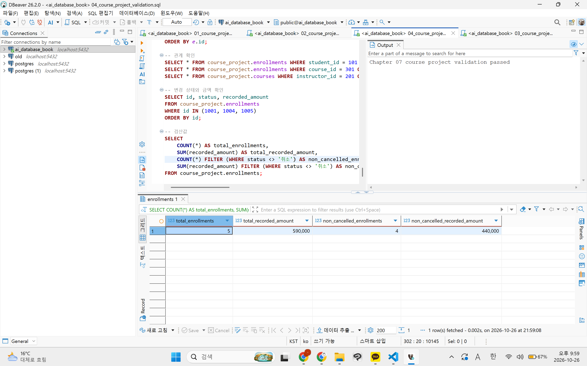
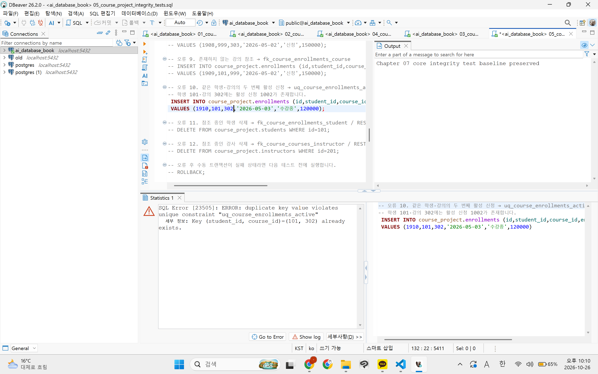
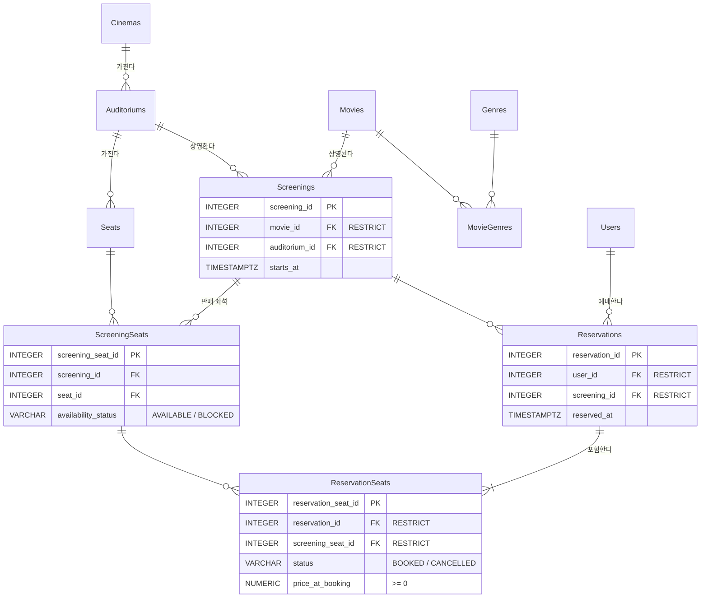

# Chapter 07 확장 실습 답안 템플릿

> **과제:** 실전 프로젝트 1 — 온라인 강의 수강신청 DB 완성하기  
> **사용 방법:** 이 파일을 내려받아 본인의 GitHub 저장소에 `chapter07_answer.md`라는 이름으로 저장한 뒤 실습하면서 바로 작성합니다.  
> **제출 방법:** LMS에는 파일을 직접 업로드하지 않고, **본인 GitHub 저장소의 `chapter07_answer.md` 파일 URL**을 제출합니다.

---

## 제출 전 주의

이 파일과 캡처 화면에는 실제 비밀번호, 전체 DB 접속 URL, API Key, 개인정보를 기록하지 않습니다.

```text
GitHub 계정 또는 별칭: 0524-youna
과제 작성일: 20261026
사용한 AI 도구: claude
```

---

# 1. 시작 환경 확인

다음을 실행합니다.

```sql
SELECT current_database();
SELECT current_user;
SELECT current_schema();
SHOW search_path;
SHOW transaction_read_only;
```

| 확인 항목 | 실제 결과 | 의미 |
| --- | --- | --- |
| `current_database()` | `ai_database_book` | 지금 접속한 DB |
| `current_user` | `postgres` | postgres 계정으로 접속 중임 |
| `current_schema()` | `public` | 스키마 생략 시 public에 테이블이 만들어짐 |
| `search_path` | `public, "$user"` | 테이블 이름만 쓰면 public부터 찾음 |
| `transaction_read_only` | `off` | 읽기 전용이 아니라 CRUD 실행 가능 |


- [x] 현재 DB가 `ai_database_book`이다.
- [x] 쓰기 가능한 연결인지 확인했다.
- [x] 실행할 SQL 범위를 확인했다.
- [x] Auto-commit 상태를 확인했다.

### 프로젝트 SQL을 실행하기 전에 시작 상태를 확인해야 하는 이유

```text
다른 DB나 읽기 전용 연결에서 실행하면 엉뚱한 곳에 객체가 생기거나 실행이 실패함. 실행 위치와 쓰기 가능 여부를 먼저 확인해야 결과를 믿을 수 있음.
```

---

# 2. 프로젝트 범위와 요구사항 읽기

## 2-1. 포함 범위

본문을 그대로 복사하지 말고 자신의 말로 정리합니다.

```text
1. 학생: 이름, 이메일, 가입일
2. 강사: 이름, 이메일, 전문 분야
3. 강의: 담당 강사, 제목, 난이도, 기준 가격, 개설일
4. 수강신청: 신청일, 상태, 신청 시 기록 금액
```

## 2-2. 제외 범위

```text
1. 실제 결제 승인·실패·환불 이력
2. 강의 정원과 대기열
3. 상태 변경 전체 이력
4. 강의 콘텐츠·진도·수료
5. 수강평·쿠폰·할인 이력
```

### 범위를 명확하게 정해야 하는 이유

```text
현재 학습 범위 안에서 정확하게 설계하고 재현 가능하게 검증할 수 있는 것을 범위로 하는 게 중요. 기능 많이 넣는 것이 좋은 기준은 아님. 범위가 없으면 테이블과 규칙이 끝없이 늘어나고 완료 기준도 정할 수 없음.
```

## 2-3. 요구사항 / 프로젝트 결정 / 미확정 질문 구분

아래 항목 중 대표 항목을 정리합니다.

| ID | 종류 | 내용 요약 | DB 구조/규칙에 미치는 영향 |
| --- | --- | --- | --- |
| P07-R01 | 요구사항 | 학생은 이름, 이메일과 가입일을 가진다. | students 테이블, name·email·joined_at NOT NULL |
| P07-R05 | 요구사항 | 수강신청은 학생, 강의, 신청일, 상태와 신청 시 기록 금액을 가진다. | enrollments 테이블, student_id·course_id FK, recorded_amount 열 |
| P07-R07 | 요구사항 | 학생·강사 이메일은 각 테이블 안에서 공백·동일 문자열 중복이 허용되지 않는다. | 테이블별 UNIQUE(email) + 공백 금지 CHECK |
| P07-D02 | 프로젝트 결정 | 할인 기능이 없는 현재 범위에서는 신청 생성 시 courses.price를 recorded_amount에 복사해 보존 | INSERT ... SELECT + NUMERIC(12, 0), 가격이 바뀌어도 과거 행은 갱신 안 함 |
| P07-D03 | 프로젝트 결정 | 같은 학생·강의의 진행 중(신청·수강중) 신청은 최대 한 건 | 부분 고유 인덱스 uq_course_enrollments_active |
| P07-Q01 | 미확정 질문 | 학생과 강사 사이에서도 이메일을 전역 고유하게 제한해야 하는가? | 아직 미확정이라 테이블별 UNIQUE만 둠. 확정되면 users 통합 모델 검토 |

### 미확정 질문을 바로 제약조건으로 만들면 안 되는 이유

```text
아직 정책이 정해지지 않았는데 제약조건으로 만들면 나중에 정상 데이터까지 막을 수 있음. 바꾸려면 구조와 데이터를 다시 고쳐야 함. 확정 전까지는 질문으로 남겨둬야 함.
```

---

# 3. 네 테이블의 한 행 의미와 관계

## 3-1. 한 행 의미

```text
course_project.students 한 행 = 학생 한 명 정보

course_project.instructors 한 행 = 강사 한 명 정보

course_project.courses 한 행 = 개설된 강의 한 개 

course_project.enrollments 한 행 = 특정 학생이 특정 강의에 신청한 사건 한 건
```

## 3-2. 키와 중요 규칙

| 테이블 | PK | FK | 중요 규칙 |
| --- | --- | --- | --- |
| students | id | 없음 | email UNIQUE, name·email 공백 금지 |
| instructors | id | 없음 | email UNIQUE, name·email·specialty 공백 금지 |
| courses | id | instructor_id → instructors.id | level은 basic/intermediate/advanced, price >= 0, 삭제 RESTRICT |
| enrollments | id | student_id → students.id, course_id → courses.id | status는 신청/수강중/완료/취소, recorded_amount >= 0, 활성 중복 신청 금지 |

## 3-3. 관계를 양방향 문장으로 작성

```text
instructors ↔ courses: 한 강사는 0개 이상의 강의를 담당할 수 있고 한 강의는 정확히 한 강사를 참조한다.

students ↔ enrollments: 한 학생은 0개 이상의 신청을 가질 수 있고 한 신청은 정확히 한 학생을 참조한다.

courses ↔ enrollments: 한 강의는 0개 이상의 신청을 가질 수 있고 한 신청은 정확히 한 강의를 참조한다.
```

### 학생과 강의의 N:M 관계가 `enrollments`를 통해 어떻게 바뀌는지 설명

```text
한 학생은 여러 강의를, 한 강의는 여러 학생을 가질 수 있어 N:M 관계임. 이를 enrollments가 두 개의 1:N 관계로 풀어줌.
students 1 -- N enrollments N -- 1 courses.
```

### `enrollments`가 단순 연결 테이블이 아니라 사건 테이블이라고 볼 수 있는 이유

```text
연결만 하는 게 아니라 enrolled_at, status, recorded_amount 등 사건 속성도 갖기 때문에. 같은 학생·강의라도 완료·취소 뒤 새 신청이 생길 수 있어 신청 한 건이 독립된 기록임.
```

---

# 4. `recorded_amount`의 의미 이해

```text
courses.price = 현재 강의 기준 가격

enrollments.recorded_amount = 신청이 만들어질 때 해당 신청 행에 기록한 금액.
```

### 두 값이 처음에는 같아도 같은 의미가 아닌 이유

```text
price는 나중에 바뀔 수 있는 현재 값이고 recorded_amount는 신청 시점에 고정된 값임. 가격이 바뀌어도 과거 신청 행은 그대로 남아야 함.
```

### `recorded_amount`를 실제 결제 성공액이나 회계 매출로 해석하면 안 되는 이유

```text
신청이 만들어질 때의 기록된 금액이기 때문에 실제로 결제로 이어졌는지 불분명함. 결제 승인·환불 이력은 현재 범위에서 제외되어 있어 매출로 볼 근거가 없음.
```

---

# 5. STEP 01 — 스키마와 테이블 생성

실행 파일:

```text
code/chapter07/01_course_project_schema.sql
```

## 5-1. 실행 전 예상

```text
course_project 스키마 존재 여부: 생성됨
예상 테이블 수: 4개    
예상 데이터 행 수: 0개
예상되는 명명 제약조건 수: 15개
예상되는 NOT NULL 열 수: 20개
부분 고유 인덱스 존재 여부: 존재
```

## 5-2. 실행 결과

```text
실제 테이블 수: 4
실제 명명 제약조건 수: 15
실제 NOT NULL 열 수: 20
부분 고유 인덱스: 존재
네 테이블의 실제 행 수:0
통과 메시지:Chapter 07 course project schema creation passed

```

### 예상과 실제 비교

```text
같음.
```

### 증거 화면

권장 경로:

```text
assignments/chapter07/images/step05_schema.png
```

`여기에 스키마/테이블 생성 검증 화면을 삽입하세요.`

---

# 6. STEP 02 — Seed 데이터 입력

실행 파일:

```text
code/chapter07/02_course_project_seed.sql
```

## 6-1. 실행 전 예상

```text
students: 3
instructors:2
courses:3
enrollments:4
recorded_amount 합계:470000
학생 101 신청 건수: 2
강의 301 신청 건수: 2
강사 201 담당 강의 수: 2
활성 중복 신청: 0
```

## 6-2. 실제 결과

```text
students: 3
instructors:2
courses:3
enrollments:4
recorded_amount 합계:470000
학생 101 신청 건수: 2
강의 301 신청 건수: 2
강사 201 담당 강의 수: 2
활성 중복 신청: 0
1001 상태: 수강중
1004 상태: 신청
1005 존재 여부: 없음
통과 메시지:Chapter 07 course project seed passed

```

### Seed 데이터를 단순 예제가 아니라 검증 데이터라고 볼 수 있는 이유

```text
1:N 관계가 실제로 만들어지는가, 같은 학생에게 여러 신청이 가능한가, 금액 검산이 가능한가 등을 확인하기 위한 검증용 기준 데이터이다. 
```

---

# 7. STEP 03 — 변경 시나리오 실행

실행 파일:

```text
code/chapter07/03_course_project_changes.sql
```

## 7-1. 실행 전에 상태 변화를 예상

| 신청 ID | 변경 전 예상 상태 | 변경 후 예상 상태 | 예상 recorded_amount |
| ---: | --- | --- | ---: |
| 1001 |  수강중|  완료|100000  |
| 1004 |  신청|  취소|150000  |
| 1005 |  없음| 신청 |120000  |

```text
변경 후 예상 enrollments 행 수:5
변경 후 예상 전체 recorded_amount 합계:590000
변경 후 예상 취소 제외 건수: 4
변경 후 예상 취소 제외 recorded_amount 합계:440000
```

## 7-2. 실제 결과

```text
1001 상태 / recorded_amount:완료 / 100000
1004 상태 / recorded_amount: 취소/ 150000
1005 상태 / recorded_amount: 신청 / 120000
최종 enrollments 행 수: 5
전체 recorded_amount 합계: 590000
취소 제외 건수:1
취소 제외 recorded_amount 합계:440000
활성 중복 신청:0
통과 메시지:Chapter 07 course project changes passed

```

### 조건부 UPDATE에서 예상 이전 상태를 확인해야 하는 이유

```text
예상과 다른 상태인데도 계속 업데이트하면 다른 작업이 진행된 데이터를 덮어쓸 수 있음. 안전하게 작업하려면 예상이전 상태를 확인하고 비교하며 해야함. 
```

### 증거 화면

권장 경로:

```text
assignments/chapter07/images/step07_changes.png
```

`여기에 주요 변경 전/후 결과를 삽입하세요.`

---

# 8. STEP 04 — 최종 완료 게이트 실행

실행 파일:

```text
code/chapter07/04_course_project_validation.sql
```

## 8-1. 최종 검증 결과

```text
최종 행 수 students/instructors/courses/enrollments: 3/2/3/5
서비스 JOIN 결과 행 수:5
학생 101 신청 수:2
강의 301 신청 수:2
강사 201 강의 수:2
고아 관계 수:0
활성 중복 신청 수:0
전체 recorded_amount:590000
취소 제외 recorded_amount:440000
통과 메시지:Chapter 07 course project validation passed
```

### SQL 파일 4개가 모두 실행되었다는 사실과 프로젝트 검증 PASS가 다른 이유

```text
파일 실행은 오류 없이 끝났다는 뜻일 뿐임. PASS는 최종 구조와 데이터가 요구사항을 만족한다는 것을 검증 SQL로 확인한 결과임.
```

### 증거 화면

권장 경로:

```text
assignments/chapter07/images/step08_validation.png
```



---

# 9. 무결성 테스트

실행 파일:

```text
code/chapter07/05_course_project_integrity_tests.sql
```

> 오류 테스트는 파일 전체를 무작정 실행하지 않고 **한 테스트 구간씩** 실행합니다.

## 9-1. 허용되어야 하는 경계값 1개

```text
테스트 내용: price = 0
기대 결과: 허용.
실제 결과: 성공. 임시 행 삭제 후 baseline preserved 메시지 확인.
왜 허용되어야 하는가: P07-D01, 무료 금액은 0으로 표현하고 NULL, 음수는 허용하지 않음. 
```

## 9-2. 실패해야 하는 테스트 1 — 잘못된 참조 또는 값

```text
테스트 내용: 학생 이메일 중복
기대 결과: 실패
실제 오류 핵심:duplicate key value violates unique constraint "uq_course_students_email"
  세부 정보: Key (email)=(minji@example.com) already exists.
동작한 제약조건/규칙: uq_course_students_email (P07-R07)
왜 실패해야 하는가: 같은 테이블 안에서 이메일은 고유해야 함.
```

## 9-3. 실패해야 하는 테스트 2 — 활성 중복 신청

```text
테스트 내용: 학생 101·강의 302의 두 번째 활성 신청
기대 결과: 실패
실제 오류 핵심:duplicate key value violates unique constraint "uq_course_enrollments_active"
  세부 정보: Key (student_id, course_id)=(101, 302) already exists.
동작한 인덱스/규칙: uq_course_enrollments_active (P07-D03)
왜 실패해야 하는가: 이미 활성 신청 1002가 있음. 같은 학생·강의의 진행 중 신청은 한 건만 허용됨.
```

## 9-4. 실패 후 기준 상태 재검증

```text
04 validation 재실행 결과:Chapter 07 course project validation passed
기준 데이터가 유지되었는가: yes
```

### 실패 테스트가 프로젝트 품질 검증에 필요한 이유

```text
정상 입력만 확인하면 잘못된 데이터를 막는지 알 수 없음. 실패 테스트로 제약조건이 실제로 동작하는지 확인해야 함.
```

### 증거 화면

권장 경로:

```text
assignments/chapter07/images/step09_integrity.png
```



---

# 10. 재현성 실험

> 이 단계는 본인의 실습 환경이며 보존할 데이터가 없을 때만 수행합니다.

실행 순서:

```text
reset_course_project.sql
→ 01_course_project_schema.sql
→ 02_course_project_seed.sql
→ 03_course_project_changes.sql
→ 04_course_project_validation.sql
```

```text
처음 실행의 최종 결과: Chapter 07 course project validation passed
재실행의 최종 결과: Chapter 07 course project validation passed

두 결과가 일치했는가: yes
중간에 수동 수정이 필요했는가: no
```

### 다른 사람이 같은 순서로 실행해 같은 결과를 얻는 것이 중요한 이유

```text
수동 수정 없이 같은 결과가 나와야 결과를 믿을 수 있음. 다음 단계나 다른 사람도 같은 기준 상태에서 시작할 수 있음.
```

---

# 11. Chapter 01~06 개인 프로젝트를 중간 프로젝트 초안으로 확장

온라인 강의 예제를 이름만 바꾸지 않고 본인의 아이디어를 사용합니다.

## 11-1. 프로젝트 기본 정보

```text
프로젝트 이름: 영화 예매 서비스

해결하려는 문제: 같은 회차의 같은 좌석이 두 번 팔리는 문제. 영화·지점·시간·남은 좌석을 한 번에 비교하기 어려운 문제.

주요 사용자: 관객(조회·예매·취소), 관리자(영화·상영관·회차 관리, 예매 현황 확인)
```

## 11-2. 포함 범위 / 제외 범위

```text
[포함]
1. 사용자, 영화·장르
2. 영화관 지점·상영관·물리 좌석
3. 상영 회차와 회차별 좌석(판매 가능 여부)
4. 예매와 좌석별 예매 기록(BOOKED / CANCELLED), 예매 당시 가격

[제외]
1. 실제 결제 승인·환불 이력
2. 쿠폰·할인·포인트
3. 좌석 등급별 가격
4. 관람평·평점
```

## 11-3. 요구사항

최소 8개를 작성합니다.

| ID | 요구사항 | 관련 테이블/관계 | 검증 방법 후보 |
| --- | --- | --- | --- |
| P07-MR01 | 사용자는 이름·이메일·역할(관객/관리자)을 가진다 | Users | 정상 입력, 이름 공백·잘못된 역할 실패 |
| P07-MR02 | 영화는 제목·상영 시간을 가진다. 상영 시간은 0보다 크다 | Movies | 0·음수 상영 시간 실패 |
| P07-MR03 | 영화와 장르는 N:M 관계다 | Movies ↔ MovieGenres ↔ Genres | 같은 영화·장르 연결 중복 실패 |
| P07-MR04 | 상영관은 한 지점에, 좌석은 한 상영관에 속한다 | Cinemas → Auditoriums → Seats FK | 없는 상영관 참조 실패 |
| P07-MR05 | 회차는 한 영화·한 상영관을 참조하고 시작 시각을 가진다 | Screenings FK | 없는 영화 참조 실패, JOIN 조회 |
| P07-MR06 | 회차별 좌석은 (회차, 좌석) 조합당 한 행이다 | ScreeningSeats UNIQUE | 같은 조합 두 번 INSERT 실패 |
| P07-MR07 | 회차별 좌석 상태는 AVAILABLE / BLOCKED 중 하나다 | ScreeningSeats CHECK | 잘못된 상태 실패 |
| P07-MR08 | 예매는 한 사용자가 한 회차를 예매한 사건이고 좌석 1개 이상을 가진다 | Users·Screenings → Reservations → ReservationSeats | 좌석 없는 예매 0건 검증 쿼리 |
| P07-MR09 | 한 회차 좌석에 BOOKED 기록은 최대 하나다 | ReservationSeats 부분 고유 인덱스 | BOOKED 두 번 실패, 취소 후 재예매 성공 |
| P07-MR10 | 예매 당시 가격은 0 이상이고 보존된다 | ReservationSeats.price_at_booking | 음수 실패, 0 성공 |

## 11-4. 프로젝트 결정

최소 3개를 작성합니다.

| ID | 이번 프로젝트에서 내린 결정 | 이유 | 구현 후보 |
| --- | --- | --- | --- |
| P07-MD01 | 예매 취소는 삭제하지 않고 CANCELLED로 변경 | 취소 이력 보존, 같은 좌석 재예매 가능 | status CHECK + 조건부 UPDATE |
| P07-MD02 | 예매 여부는 ScreeningSeats에 저장하지 않고 ReservationSeats의 BOOKED 기록으로 판단 | 같은 사실을 두 곳에 저장하면 불일치 위험 | availability_status는 AVAILABLE / BLOCKED만 |
| P07-MD03 | 예매 당시 가격을 price_at_booking에 복사해 보존 | 가격이 바뀌어도 과거 예매 금액은 유지 | INSERT ... SELECT, NUMERIC(12, 0) |
| P07-MD04 | 이력 있는 부모(사용자·회차·좌석) 삭제는 제한 | 예매 이력 보호 | ON DELETE RESTRICT |

## 11-5. 미확정 질문

최소 3개를 작성합니다.

```text
P07-MQ01. 여러 좌석 예매 중 일부 좌석만 취소할 수 있는가?
P07-MQ02. 취소 가능 시한을 둘 것인가? (예: 상영 시작 전까지)
P07-MQ03. 같은 상영관에서 회차 시간이 겹치는 것을 DB에서 막을 것인가?
P07-MQ04. Users.email을 고유하게 제한할 것인가?
```

---

# 12. 개인 프로젝트 ERD와 한 행 의미

## 12-1. 테이블 후보

최소 4개를 권장합니다.

| 테이블 | 한 행의 의미 | PK 후보 | FK 후보 | 주요 규칙 |
| --- | --- | --- | --- | --- |
| Users | 사용자 한 명 | user_id | 없음 | 이름 공백 금지, role은 CUSTOMER / ADMIN |
| Movies | 영화 한 편 | movie_id | 없음 | 제목 공백 금지, running_minutes > 0 |
| Genres | 장르 한 종류 | genre_id | 없음 | 장르 이름 UNIQUE |
| MovieGenres | 영화 한 편과 장르 한 종류의 연결 | (movie_id, genre_id) | movie_id, genre_id | 같은 연결 중복 금지 |
| Cinemas | 영화관 지점 한 곳 | cinema_id | 없음 | 지점 이름 공백 금지 |
| Auditoriums | 지점 안의 상영관 한 개 | auditorium_id | cinema_id | RESTRICT |
| Seats | 상영관의 물리 좌석 한 개 | seat_id | auditorium_id | (auditorium_id, 열, 번호) UNIQUE |
| Screenings | 특정 영화를 특정 상영관에서 상영하는 회차 한 건 | screening_id | movie_id, auditorium_id | starts_at NOT NULL, RESTRICT |
| ScreeningSeats | 특정 회차의 특정 좌석 한 개와 판매 가능 여부 | screening_seat_id | screening_id, seat_id | (screening_id, seat_id) UNIQUE, AVAILABLE / BLOCKED |
| Reservations | 사용자가 한 회차를 예매한 사건 한 건 | reservation_id | user_id, screening_id | RESTRICT |
| ReservationSeats | 예매 한 건에 포함된 좌석 예매 기록 한 건 | reservation_seat_id | reservation_id, screening_seat_id | BOOKED / CANCELLED, BOOKED 부분 고유 인덱스, price_at_booking >= 0 |

## 12-2. 관계 문장

```text
1. Cinemas ↔ Auditoriums ↔ Seats: 한 지점은 0개 이상의 상영관을, 한 상영관은 0개 이상의 좌석을 가진다. 각 상영관·좌석은 정확히 한 부모를 참조한다.
2. Movies·Auditoriums ↔ Screenings: 한 영화·한 상영관은 0개 이상의 회차를 가지고, 한 회차는 정확히 한 영화와 한 상영관을 참조한다.
3. Screenings·Seats ↔ ScreeningSeats: 회차와 좌석의 N:M 관계를 ScreeningSeats가 풀어준다. (회차, 좌석) 조합당 한 행.
4. Users·Screenings ↔ Reservations: 한 사용자·한 회차는 0개 이상의 예매를 가지고, 한 예매는 정확히 한 사용자와 한 회차를 참조한다.
5. Reservations ↔ ReservationSeats ↔ ScreeningSeats: 한 예매는 1개 이상의 좌석 기록을 가진다. 한 회차 좌석은 0개 이상의 기록을 가지지만 BOOKED는 최대 하나다.
6. Movies ↔ Genres: N:M 관계를 MovieGenres가 풀어준다.
```

## 12-3. ERD

권장 이미지 경로:

```text
assignments/chapter07/images/personal_project_erd.png
```



### Chapter 05~06 ERD에서 이번에 바꾼 점

```text
- Chapter 06 AI 리뷰 결과를 반영해 모든 FK를 CASCADE가 아닌 RESTRICT로 정함.
- BOOKED 부분 고유 인덱스와 price_at_booking >= 0 규칙을 ERD에 표시함.
- Reservations.screening_id와 좌석의 회차 일치는 검증 쿼리로 확인하기로 함.
- 회차 시간 겹침, email UNIQUE는 미확정 질문으로 남김.
```

---

# 13. 개인 프로젝트 완료 기준 만들기

“잘 동작한다”처럼 모호하게 쓰지 말고 검증 가능한 기준을 최소 6개 작성합니다.

| 번호 | 완료 기준 | 자동 SQL 검증 가능? | 검증 방법 |
| ---: | --- | --- | --- |
| 1 | 테이블 11개가 정확히 존재한다. | 가능 | information_schema.tables 개수 조회 |
| 2 | Seed 후 Users/Movies/Cinemas/Reservations 행 수가 10/10/3/20 이상이다. | 가능 | COUNT(*) 비교 후 다르면 RAISE EXCEPTION |
| 3 | 존재하지 않는 부모를 참조하는 행이 0건이다. | 가능 | LEFT JOIN ... WHERE 부모 IS NULL 개수 조회 |
| 4 | 허용되지 않은 상태 입력(예: 'RESERVED')이 실패한다. | 가능 | 실패 테스트 INSERT → CHECK 오류 확인 |
| 5 | 같은 회차 좌석의 두 번째 BOOKED 기록이 차단된다. 취소 후 재예매는 성공한다. | 가능 | 실패 테스트 + 성공 테스트 |
| 6 | Reservations.screening_id와 좌석의 회차가 다른 행이 0건이다. | 가능 | ReservationSeats → ScreeningSeats JOIN 비교 |
| 7 | 좌석 기록이 없는 예매가 0건이다. | 가능 | NOT EXISTS 조회 |
| 8 | 최종 validation SQL이 PASS를 반환한다. | 가능 | validation 파일 실행 후 통과 메시지 확인 |

예시 형식:

```text
Seed 실행 후 A/B/C/D 테이블의 행 수가 각각 5/3/8/12다.
존재하지 않는 부모를 참조하는 행은 0건이다.
허용되지 않은 상태 입력은 DB가 거부한다.
검증 SQL이 예상 결과를 반환한다.
```

---

# 14. AI를 프로젝트 리뷰어로 사용

AI에게 프로젝트를 대신 완성시키지 않고 누락과 위험을 찾게 합니다.

## 14-1. AI에게 전달한 핵심 자료

```text
요구사항: 11-3의 P07-MR01~MR10

테이블/ERD 설명: 12-1 테이블 11개의 한 행 의미, 12-3 ERD

프로젝트 결정: P07-MD01~MD04 (취소는 상태 변경, 예매 여부는 BOOKED 기록으로 판단, 당시 가격 보존, RESTRICT)

미확정 질문: P07-MQ01~MQ04 (일부 취소, 취소 시한, 회차 시간 겹침, email UNIQUE)

완료 기준: 13번 기준 1~8
```

## 14-2. 내가 사용한 프롬프트

```text
나는 데이터베이스 입문 수업의 중간 프로젝트 초안을 작성하고 있습니다.
아래 프로젝트를 대신 완성하지 말고 리뷰어로 검토해 주세요.
특히 다음을 찾아 주세요.
1. 요구사항과 ERD가 연결되지 않는 부분
2. 한 행의 의미가 섞인 테이블
3. 빠진 PK/FK 관계 후보
4. 근거 없이 추가한 UNIQUE / NOT NULL / CHECK / CASCADE
5. 미확정 정책을 내가 임의로 확정한 부분
6. Seed 데이터로 검증하기 어려운 요구사항
7. 모호해서 자동 검증할 수 없는 완료 기준
8. 아직 배우지 않은 기능을 꼭 넣지 않아도 되는 부분
정답 ERD나 전체 SQL을 먼저 작성하지 말고,
문제점과 확인 질문을 우선순위 순으로 알려 주세요.
[내 프로젝트 내용]
```

## 14-3. AI 제안 검토

| AI 제안 | 수용 / 수정 / 보류 / 거절 | 실제 근거 | 반영 내용 |
| --- | --- | --- | --- |
| 좌석 기록이 없는 예매를 찾는 완료 기준 추가 | 수용 | P07-MR08 (예매는 좌석 1개 이상) | 13번 기준 7 추가 |
| Reservations와 좌석의 회차 일치를 트리거로 강제 | 수정 | P07-MR08, 트리거는 아직 안 배움 | 우선 검증 쿼리(기준 6)로 확인 |
| 같은 상영관 회차 시간 겹침을 EXCLUDE 제약으로 차단 | 보류 | P07-MQ03 미확정, EXCLUDE 미학습 | 미확정 질문으로 유지 |
| 예매 취소 시 price_at_booking을 0으로 변경 | 거절 | P07-MD03 (당시 가격 보존), 환불은 제외 범위 | 원래 값 유지 |

### AI가 미확정 정책을 임의로 확정하려 한 부분이 있었나요?

```text
있었음. 회차 시간 겹침 금지를 바로 제약조건으로 넣자고 함.
P07-MQ03 미확정이라 보류함.
```

### AI가 제안한 규칙 중 아직 배우지 않은 기능이라 보류한 것이 있나요?

```text
있었음. 회차 일치 강제용 트리거, 시간 겹침용 EXCLUDE 제약, 동시 예매 제어.
지금은 검증 쿼리로 확인하고 트랜잭션 학습 후 다시 검토함.
```

### AI 활용 후 실제로 좋아진 부분

```text
좌석 없는 예매, 회차 불일치처럼 놓친 검증 기준을 찾음.
완료 기준이 전부 SQL로 확인 가능한 문장이 됨.
```

---

# 15. 최종 성찰

아래 문장은 반드시 본인의 말로 작성합니다.

```text
1. 데이터베이스 프로젝트가 완료되었다고 판단하려면
   SQL 파일의 존재보다 최종 구조와 데이터가 요구사항을 만족하는지 검증 SQL로 확인한 결과 이 중요하다.

2. Seed 데이터의 목적은 단순히 화면을 채우는 것이 아니라
   관계·중복 규칙·금액 검산이 예상대로 동작하는지 확인하는 기준 상태를 만드는 것 이다.

3. 실패 테스트가 필요한 이유는
   잘못된 데이터를 DB가 실제로 막는지, 실패 후에도 기준 데이터가 그대로인지 확인하기 위해서 이다.

4. 요구사항과 프로젝트 결정을 구분해야 하는 이유는
   요구사항은 꼭 지켜야 하는 것이고, 결정은 현재 범위에서 고른 방법이라 범위가 바뀌면 다시 정할 수 있기 때문 이다.

5. 내가 만든 개인 프로젝트에서 가장 먼저 추가 확인해야 할 정책은
   여러 좌석 예매 중 일부 좌석만 취소할 수 있는지 이다.
```

---

# 16. 제출 체크리스트

- [ ] `chapter07_answer.md`를 본인 저장소에 만들었다.
- [ ] 시작 환경과 현재 DB를 확인했다.
- [ ] 프로젝트 포함/제외 범위를 설명했다.
- [ ] 요구사항/결정/미확정 질문을 구분했다.
- [ ] 네 테이블의 한 행 의미와 관계를 설명했다.
- [ ] `01_course_project_schema.sql`을 실행하고 결과를 확인했다.
- [ ] `02_course_project_seed.sql`의 기준 상태를 확인했다.
- [ ] `03_course_project_changes.sql` 전후 상태를 비교했다.
- [ ] `04_course_project_validation.sql` PASS를 확인했다.
- [ ] 허용 경계값 1개 이상을 확인했다.
- [ ] 실패 테스트 2개 이상을 한 구간씩 실행했다.
- [ ] 실패 후 validation을 다시 실행했다.
- [ ] 개인 프로젝트 요구사항 8개 이상을 작성했다.
- [ ] 프로젝트 결정 3개 이상과 미확정 질문 3개 이상을 작성했다.
- [ ] 개인 프로젝트 ERD를 작성했다.
- [ ] 검증 가능한 완료 기준 6개 이상을 작성했다.
- [ ] AI 제안을 수용/수정/보류/거절로 구분했다.
- [ ] 핵심 캡처는 3~4장 정도로 정리했다.
- [ ] 캡처에 비밀번호나 개인정보가 없다.
- [ ] GitHub 웹에서 Markdown과 이미지가 정상적으로 보인다.
- [ ] 최종 파일을 commit/push했다.

---

# 17. LMS 제출 URL

아래 형식의 **본인 GitHub 파일 URL**을 LMS에 제출합니다.

```text
https://github.com/<본인-GitHub-ID>/<본인-저장소>/blob/main/assignments/chapter07/chapter07_answer.md
```

내 제출 URL:

```text
https://github.com/0524youna-gif/2602database/blob/main/assignments/chapter07/chapter07_answer.md
```

> 저장소 메인 URL, 교수자 템플릿 URL, Raw URL이 아니라 **작성 완료된 본인 `chapter07_answer.md` 파일 화면 URL**을 제출합니다.
