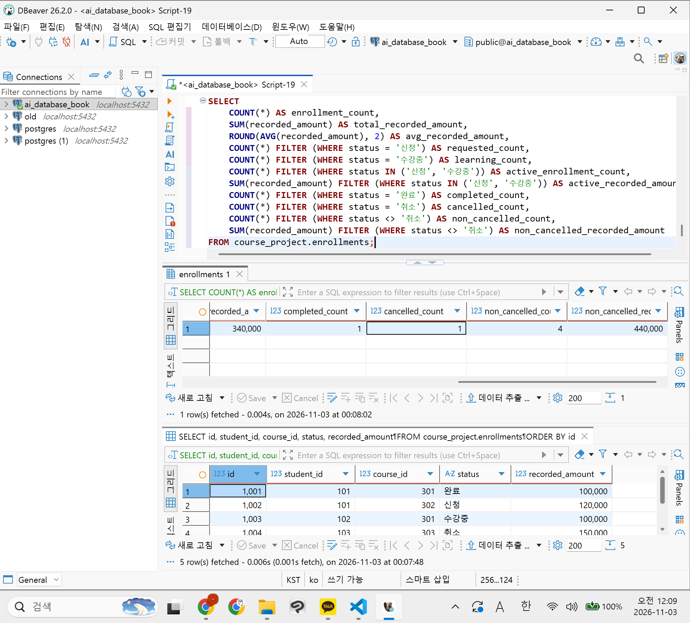
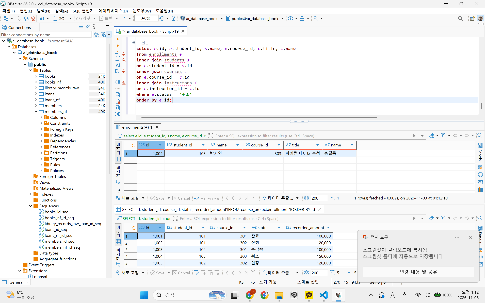
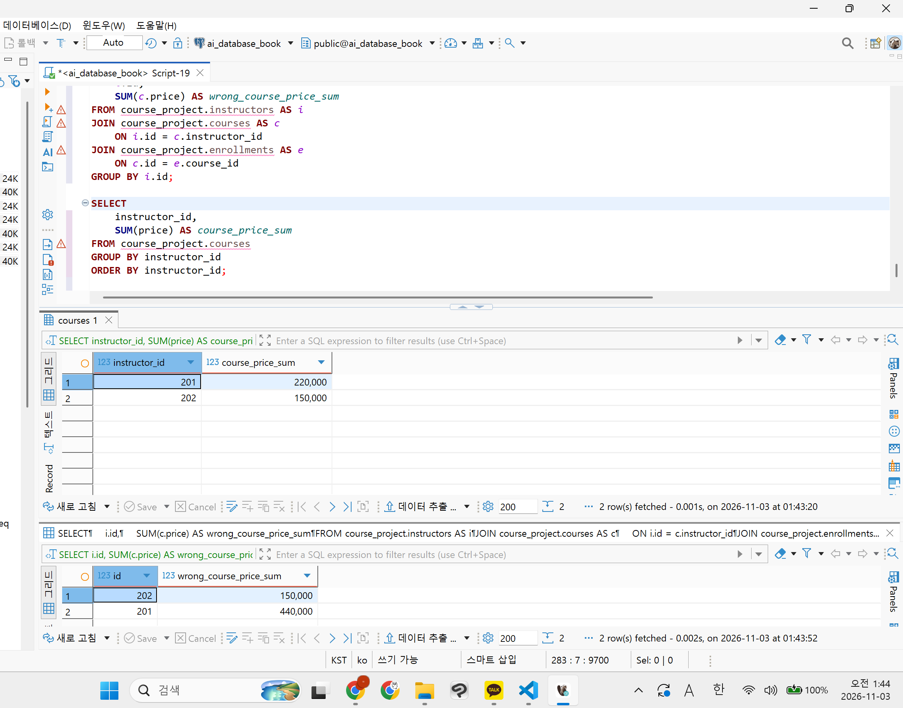

# Chapter 08 확장 실습 답안 템플릿

> **과제:** JOIN과 집계로 서비스 질문에 답하기  
> **사용 방법:** 이 파일을 내려받아 본인의 GitHub 저장소에 `chapter08_answer.md`라는 이름으로 저장한 뒤 실습하면서 바로 작성합니다.  
> **제출 방법:** LMS에는 파일을 직접 업로드하지 않고, **본인 GitHub 저장소의 `chapter08_answer.md` 파일 URL**을 제출합니다.

---

## 제출 전 주의

이 파일과 캡처 화면에는 실제 비밀번호, 전체 DB 접속 URL, API Key, 개인정보를 기록하지 않습니다.

```text
GitHub 계정 또는 별칭:0524youna
과제 작성일:2026/11/02
사용한 AI 도구:claude
```

---

# 1. Chapter 07 기준 상태 확인

다음을 실행합니다.

```text
code/chapter08/00_check_course_project.sql
```

## 1-1. 사전 검사 결과

```text
검증 메시지: Chapter 08 prerequisite check passed

students 행 수:3
instructors 행 수:2
courses 행 수:3
enrollments 행 수:5

전체 신청 건수:5
전체 recorded_amount:590,000
활성 신청 건수:3
활성 recorded_amount: 340,000
취소 제외 신청 건수:4
취소 제외 recorded_amount:440,000
```

기준값:

```text
students = 3
instructors = 2
courses = 3
enrollments = 5

전체 = 5 / 590000
활성 = 3 / 340000
취소 제외 = 4 / 440000
```

### 기준값이 다르면 그대로 진행하면 안 되는 이유

```text
Chapter 08의 JOIN·집계 결과는 이 기준값을 정답으로 삼아 검산함. 시작 데이터가 다르면 결과가 틀려도 SQL 문제인지 데이터 문제인지 구분할 수 없음. Chapter 07 파일을 다시 실행해 기준 상태로 맞춘 뒤 진행해야 함.
```

### 증거 화면

권장 경로:

```text
assignments/chapter08/images/step01_prerequisite.png
```



---

# 2. 업무 질문을 SQL보다 먼저 정의하기

다음 세 질문을 각각 SQL 작성 전에 먼저 정의합니다.

## 질문 A

```text
업무 질문: 강의별로 취소되지 않은 신청이 몇 건인지 보여주세요. 신청이 없는 강의도 0건으로 보여야 함.
결과 한 행의 의미: 강의 한 개와 그 강의의 취소 제외 신청 수
포함 상태: 신청, 수강중, 완료
제외 상태: 취소
JOIN할 테이블: courses, enrollments
JOIN 경로: courses.id = enrollments.course_id
INNER JOIN / LEFT JOIN 선택: LEFT JOIN (courses 기준)
그 이유: 강의 303은 취소 신청 1004만 있어 취소 제외 신청이 0건임. INNER JOIN이면 303이 결과에서 사라짐. 강의를 모두 남기려면 LEFT JOIN을 쓰고, 취소 제외 조건은 WHERE가 아니라 ON에 둬야 함. 개수는 COUNT(*)가 아니라 COUNT(e.id)로 셈.
예상 행 수: 3행 (301 → 2건, 302 → 2건, 303 → 0건)
```

## 질문 B

```text
업무 질문: 강사별로 취소되지 않은 신청 수와 recorded_amount 합계를 보여주세요.
결과 한 행의 의미: 강사 한 명과 그 강사 강의들의 취소 제외 신청 수·기록 금액 합계
포함 상태: 신청, 수강중, 완료
제외 상태: 취소
JOIN할 테이블: instructors, courses, enrollments
JOIN 경로: instructors.id = courses.instructor_id → courses.id = enrollments.course_id
집계 대상: COUNT(e.id), SUM(e.recorded_amount) (강의 price가 아님)
예상 결과: 2행. 201 → 4건 / 440000, 202 → 0건 / 0
```

## 질문 C

```text
업무 질문: 학생별로 취소되지 않은 신청이 몇 건인지 보여주세요.
결과 한 행의 의미: 학생 한 명과 그 학생의 취소 제외 신청 수
포함 상태: 신청, 수강중, 완료
제외 상태: 취소
0건인 부모도 보여야 하는가: 예. 103은 취소 신청만 있어도 0건으로 보여야 함.
NULL을 어떻게 해석할 것인가: LEFT JOIN 후 e.id가 NULL이면 취소 제외 신청이 없다는 뜻. COUNT(e.id)로 0으로 셈.
예상 결과: 3행. 101 → 2건, 102 → 2건, 103 → 0건
```

---

# 3. INNER JOIN과 다중 JOIN

## 3-1. 신청 한 건마다 학생 이름과 강의 제목 조회

실행 전 예상:

```text
결과 한 행 = enrollments 한 건 
예상 행 수 = 5
JOIN 경로 = enrollments.student_id = students.id, enrollments.course_id = courses.id
```

내가 실행한 SQL:

```sql

SELECT

    e.id AS enrollment_id,

    s.name AS student_name,

    c.title AS course_title,

    e.status

FROM course_project.enrollments AS e

INNER JOIN course_project.students AS s

    ON e.student_id = s.id

INNER JOIN course_project.courses AS c

    ON e.course_id = c.id

ORDER BY e.id;


```

실제 결과:

```text
실제 행 수: 5
예상과 일치 여부: 일치
```

### 학생 이름이 여러 번 보이는 것이 중복 오류가 아닐 수 있는 이유

```text
결과 한 행은 학생이 아니라 신청 한 건임. 김민지(1001, 1002), 이준호(1003, 1005)는 신청이 2건이라 두 번 보이는 게 정상.
```

## 3-2. 학생·강의·강사까지 연결

```text
결과 한 행 = enrollments 한 건 (학생·강의·강사 정보를 붙인 것)
강사까지 가는 JOIN 경로 = enrollments → courses (e.course_id = c.id) → instructors (c.instructor_id = i.id)
```

```sql

SELECT

    e.id AS enrollment_id,

    s.name AS student_name,

    c.title AS course_title,

    i.name AS instructor_name,

    e.status,

    e.recorded_amount,

    e.enrolled_at

FROM course_project.enrollments AS e

JOIN course_project.students AS s

    ON e.student_id = s.id

JOIN course_project.courses AS c

    ON e.course_id = c.id

JOIN course_project.instructors AS i

    ON c.instructor_id = i.id

ORDER BY e.id;

```

실제 행 수:

```text
5 (강사를 붙여도 신청 한 건당 강사는 한 명이라 행 수가 늘지 않음)
```

### 증거 화면

권장 경로:

```text
assignments/chapter08/images/step03_inner_join.png
```



---

# 4. LEFT JOIN과 0건 표현

## 4-1. 강의별 취소 제외 신청 수

신청이 없는 강의도 결과에 남도록 작성합니다.

실행 전:

```text
결과 한 행 = 강의 한 개
강의 303의 예상 실제 신청 수 = 0 (1004는 취소라 제외)
강의 303의 예상 고유 학생 수 = 0
강의 303의 예상 recorded_amount = 0
```

내 SQL:

```sql

SELECT

    c.id AS course_id,
    c.title AS course_title,
    COUNT(e.id) AS non_cancelled_count,
    COUNT(DISTINCT e.student_id) AS student_count,
    COALESCE(SUM(e.recorded_amount), 0) AS non_cancelled_recorded_amount
FROM course_project.courses AS c
LEFT JOIN course_project.enrollments AS e
    ON c.id = e.course_id
   AND e.status <> '취소'
GROUP BY c.id, c.title
ORDER BY c.id;

```

실제 결과:

```text
강의 301: 신청 2건 / 학생 2명 / 200000
강의 302: 신청 2건 / 학생 2명 / 240000
강의 303: 신청 0건 / 학생 0명 / 0
```

## 4-2. `COUNT(*)`와 `COUNT(e.id)` 비교

강의 303을 기준으로 작성합니다.

```text
COUNT(*) 결과: 1
COUNT(e.id) 결과: 0
COUNT(DISTINCT e.student_id) 결과: 0
```

### 왜 `COUNT(*) = 1`인데 실제 신청 수는 0일 수 있나요?

```text
LEFT JOIN은 신청이 없는 강의도 한 행으로 남기고 e 쪽 열을 NULL로 채움. COUNT(*)는 이 행 자체를 세서 1이 됨. 실제 신청은 없음.
```

### 자식 사건 수를 셀 때 `COUNT(child.id)`가 더 적절한 이유

```text
COUNT(child.id)는 NULL을 세지 않음. 실제로 연결된 자식 행만 세므로 0건이 0으로 나옴.
```

---

# 5. `LEFT JOIN`에서 `ON`과 `WHERE` 조건 비교

취소 제외 신청만 연결한다고 가정합니다.

## 5-1. 조건을 `ON`에 둔 경우

```sql

SELECT

    s.id,

    s.name,

    COUNT(e.id) AS non_cancelled_count

FROM course_project.students AS s

LEFT JOIN course_project.enrollments AS e

    ON s.id = e.student_id

   AND e.status <> '취소'

GROUP BY s.id, s.name

ORDER BY s.id;

```

```text
결과 학생 수: 3 (김민지 2, 이준호 2, 박서연 0)
박서연 포함 여부: 포함 (0건으로 표시)
```

## 5-2. 조건을 `WHERE`에 둔 경우

```sql

SELECT

    s.id,

    s.name,

    COUNT(e.id) AS non_cancelled_count

FROM course_project.students AS s

LEFT JOIN course_project.enrollments AS e

    ON s.id = e.student_id

WHERE e.status <> '취소'

GROUP BY s.id, s.name

ORDER BY s.id;

```

```text
결과 학생 수: 2 (김민지 2, 이준호 2)
박서연 포함 여부: 미포함
```

## 5-3. 차이 설명

```text
ON 조건이 LEFT JOIN의 오른쪽 연결 대상을 제한하는 방식:
취소가 아닌 신청만 붙임. 붙을 신청이 없어도 학생 행은 NULL로 남음.

WHERE 조건이 JOIN 이후 결과 행을 제거하는 방식:
JOIN을 다 한 뒤 조건에 안 맞는 행을 지움. NULL 행도 조건을 통과 못 해 지워짐.

이번 사례에서 ON = 3명, WHERE = 2명이 되는 이유:
박서연은 취소 신청 1004만 있음. ON이면 NULL 행으로 남아 0건으로 보임. WHERE면 '취소' 행이 지워져 박서연이 사라짐.
```

---

# 6. 신청이 없는 학생 찾기 — 두 방법 비교

## 방법 1. `LEFT JOIN ... IS NULL`

```sql

SELECT

    s.id,

    s.name,

    s.email

FROM course_project.students AS s

LEFT JOIN course_project.enrollments AS e

    ON s.id = e.student_id

   AND e.status <> '취소'

WHERE e.id IS NULL;

```

## 방법 2. `NOT EXISTS`

```sql

SELECT

    s.id,

    s.name,

    s.email

FROM course_project.students AS s

WHERE NOT EXISTS (

    SELECT 1

    FROM course_project.enrollments AS e

    WHERE e.student_id = s.id

      AND e.status <> '취소'

);

```

```text
방법 1 결과: 1행
방법 2 결과: 1행
두 결과가 같은가: 같음
찾아진 학생: 103 박서연 (seoyeon@example.com)
```

### 두 방식의 공통 의미를 자신의 말로 설명

```text
둘 다 "취소가 아닌 신청이 하나도 없는 학생"을 찾음. 방법 1은 붙은 신청이 없어 NULL인 행을 고르고, 방법 2는 그런 신청이 존재하지 않는 학생을 고름.
```

---

# 7. 기본 집계 검산

다음 결과를 직접 확인합니다.

| 분석 범위 | 예상 건수 | 실제 건수 | 예상 금액 | 실제 금액 | 일치? |
| --- | ---: | ---: | ---: | ---: | --- |
| 전체 신청 | 5 | 5 | 590000 | 590000 | O |
| 활성 신청 | 3 | 3 | 340000 | 340000 | O |
| 취소 제외 | 4 | 4 | 440000 | 440000 | O |
| 취소 | 1 | 1 | 150000 | 150000 | O |

참고용 SQL:

```sql
SELECT
    COUNT(*) AS enrollment_count,
    SUM(recorded_amount) AS total_recorded_amount,
    ROUND(AVG(recorded_amount), 2) AS avg_recorded_amount,
    MIN(recorded_amount) AS min_recorded_amount,
    MAX(recorded_amount) AS max_recorded_amount
FROM course_project.enrollments;
```

```text
결과: 5건 / 590000 / 평균 118000.00 / 최소 100000 / 최대 150000
```

## 7-1. 전체 평균 `recorded_amount`

```text
예상 평균: 590000 / 5 = 118000.00
실제 평균: 118000.00
```

## 7-2. 취소 제외 평균

```text
예상 평균: 440000 / 4 = 110000.00
실제 평균: 110000.00
```

### `recorded_amount`를 실제 회계 매출이라고 부르면 안 되는 이유

```text
신청할 때 기록한 금액일 뿐임. 실제 결제·환불 여부는 알 수 없음. 결제 이력은 이번 범위에서 제외됨.
```

---

# 8. `GROUP BY`, `HAVING`, `FILTER`

## 8-1. 상태별 신청 건수

```sql

SELECT

    status,

    COUNT(*) AS enrollment_count,

    SUM(recorded_amount) AS total_recorded_amount

FROM course_project.enrollments

GROUP BY status

ORDER BY CASE status

    WHEN '신청' THEN 1

    WHEN '수강중' THEN 2

    WHEN '완료' THEN 3

    WHEN '취소' THEN 4

    ELSE 99

END;

```

결과:

```text
신청: 2건 / 240000
수강중: 1건 / 100000
완료: 1건 / 100000
취소: 1건 / 150000
상태별 합계: 5건 / 590000
```

### 상태별 건수 합이 전체 신청 5건과 맞는지 검산

```text
2 + 1 + 1 + 1 = 5건. 금액도 240000 + 100000 + 100000 + 150000 = 590000. 전체와 일치.
```

## 8-2. 강의별 취소 제외 신청 수와 금액

```sql
SELECT
    c.id AS course_id,
    c.title AS course_title,
    COUNT(e.id) AS non_cancelled_count,
    COUNT(DISTINCT e.student_id) AS student_count,
    COALESCE(SUM(e.recorded_amount), 0) AS non_cancelled_recorded_amount
FROM course_project.courses AS c
LEFT JOIN course_project.enrollments AS e
    ON c.id = e.course_id
   AND e.status <> '취소'
GROUP BY c.id, c.title
ORDER BY c.id;
```

```text
강의 301: 2건 / 학생 2명 / 200000
강의 302: 2건 / 학생 2명 / 240000
강의 303: 0건 / 학생 0명 / 0
강의별 합계를 다시 더한 값: 200000 + 240000 + 0 = 440000
전체 취소 제외 기준 440000과 일치 여부: 일치
```

## 8-3. `HAVING` 사용

취소 제외 신청이 2건 이상인 강의를 조회합니다.

```sql

SELECT

    c.id,

    c.title,

    COUNT(e.id) AS enrollment_count

FROM course_project.courses AS c

JOIN course_project.enrollments AS e

    ON c.id = e.course_id

WHERE e.status <> '취소'

GROUP BY c.id, c.title

HAVING COUNT(e.id) >= 2

ORDER BY c.id;
```

```text
예상 강의 수: 2 (301, 302)
실제 강의 수: 2 (303은 0건이라 제외)
```

---

# 9. 과대 집계 오류 직접 관찰

강사 201의 강의 가격 합계를 구한다고 가정합니다.

## 9-1. 신청까지 JOIN해서 잘못 집계한 결과

```sql

SELECT

    i.id,

    SUM(c.price) AS wrong_course_price_sum

FROM course_project.instructors AS i

JOIN course_project.courses AS c

    ON i.id = c.instructor_id

JOIN course_project.enrollments AS e

    ON c.id = e.course_id

GROUP BY i.id;
```

```text
강사 201 잘못된 가격 합계: 440000
```

본문 기준:

```text
440000
```

## 9-2. 강의 수준에서 올바르게 집계

```sql

SELECT

    instructor_id,

    SUM(price) AS course_price_sum

FROM course_project.courses

GROUP BY instructor_id

ORDER BY instructor_id;
```

```text
강사 201 올바른 가격 합계: 220000
```

본문 기준:

```text
220000
```

## 9-3. 왜 두 결과가 달라졌나요?

```text
JOIN 전 강의 행 수: 강사 201의 강의는 2행 (301, 302)
JOIN 후 강의가 반복된 이유: 신청 수만큼 강의 행이 복제됨. 301은 신청 2건, 302도 2건이라 4행이 됨.
SUM이 무엇을 반복해서 더했는가: 강의 가격을 신청 수만큼 더함. 100000×2 + 120000×2 = 440000.
```

### `SUM(DISTINCT c.price)`를 일반적인 해결책으로 사용하면 안 되는 이유

```text
DISTINCT는 같은 강의가 아니라 같은 가격 값을 하나로 묶음. 서로 다른 강의의 가격이 같으면 하나가 빠져 합계가 틀림. 처음부터 강의 수준에서 집계해야 함.
```

### 증거 화면

권장 경로:

```text
assignments/chapter08/images/step09_over_aggregation.png
```



---

# 10. 상세 결과 ↔ 집계 결과 교차 검산

강의 하나를 선택합니다.

```text
선택한 course_id: 302
강의 제목: 정규화 실습 (취소 제외 기준)
```

## 10-1. 상세 신청 행 조회

```sql
SELECT
    e.id AS enrollment_id,
    s.name AS student_name,
    e.status,
    e.recorded_amount
FROM course_project.enrollments AS e
JOIN course_project.students AS s
    ON e.student_id = s.id
WHERE e.course_id = 302
  AND e.status <> '취소'
ORDER BY e.id;
```

```text
상세 행 수: 2 (1002 김민지 신청 120000, 1005 이준호 신청 120000)
상세 recorded_amount를 직접 더한 값: 120000 + 120000 = 240000
```

## 10-2. 집계 SQL

```sql
SELECT
    COUNT(e.id) AS non_cancelled_count,
    COALESCE(SUM(e.recorded_amount), 0) AS non_cancelled_recorded_amount
FROM course_project.enrollments AS e
WHERE e.course_id = 302
  AND e.status <> '취소';
```

```text
집계 건수: 2
집계 금액: 240000
```

## 10-3. 비교

```text
상세 행 수와 COUNT 결과 일치 여부: 일치 (2 = 2)
상세 금액 합과 SUM 결과 일치 여부: 일치 (240000 = 240000)
다르다면 원인: 해당 없음. 다르다면 두 SQL의 상태 조건이 다르거나 JOIN으로 행이 복제된 경우임.
```

---

# 11. 자동 완료 게이트

다음을 실행합니다.

```text
code/chapter08/03_join_aggregation_validation.sql
```

```text
최종 검증 메시지: Chapter 08 join and aggregation validation passed
```

기대 메시지:

```text
Chapter 08 join and aggregation validation passed
```

### 자동 검증이 통과했어도 사람이 SQL 의미를 설명해야 하는 이유

```text
자동 검증은 숫자가 기준값과 같은지만 확인함. 질문에 맞는 SQL인지는 모름. 데이터가 바뀌면 우연히 맞던 SQL이 틀릴 수 있음.
```

---

# 12. 개인 프로젝트 업무 질문 3개 만들기

Chapter 07에서 작성한 개인 프로젝트를 사용합니다.

개인 프로젝트: 영화 예매 서비스 (Chapter 07 11~12번)

| 질문 ID | 업무 질문 | 결과 한 행 | 포함/제외 범위 | JOIN 경로 | 집계 대상 | 검산 방법 |
| --- | --- | --- | --- | --- | --- | --- |
| P08-Q01 | 회차별로 남은 좌석이 몇 개인가? | 회차 한 건 | AVAILABLE이고 BOOKED 기록이 없는 좌석만. BLOCKED·BOOKED 제외 | screenings → screening_seats → reservation_seats(BOOKED만, LEFT JOIN) | COUNT(ss.screening_seat_id) | 전체 좌석 = 남은 + BOOKED + BLOCKED |
| P08-Q02 | 영화별 예매된 좌석 수와 예매 당시 금액 합계는? 예매 없는 영화도 0으로 | 영화 한 편 | BOOKED 포함, CANCELLED 제외 | movies → screenings → reservations → reservation_seats (모두 LEFT JOIN) | COUNT(rs.reservation_seat_id), SUM(rs.price_at_booking) | 영화별 합계를 더한 값 = 전체 BOOKED 좌석 수·금액 |
| P08-Q03 | 사용자별 예매 건수와 취소 좌석 수는? | 사용자 한 명 | 모든 예매. 취소 좌석은 CANCELLED만 | users → reservations → reservation_seats (LEFT JOIN) | COUNT(DISTINCT r.reservation_id), COUNT(rs.reservation_seat_id) FILTER CANCELLED | 사용자별 예매 건수 합 = reservations 전체 행 수 |

## 12-1. 질문 1 SQL

```sql
-- P08-Q01. 회차별 남은 좌석 수 (미실행)
SELECT
    sc.screening_id,
    sc.starts_at,
    COUNT(ss.screening_seat_id) AS total_seat_count,
    COUNT(ss.screening_seat_id) FILTER (
        WHERE ss.availability_status = 'AVAILABLE'
          AND rs.reservation_seat_id IS NULL
    ) AS remaining_seat_count
FROM screenings AS sc
LEFT JOIN screening_seats AS ss
    ON sc.screening_id = ss.screening_id
LEFT JOIN reservation_seats AS rs
    ON ss.screening_seat_id = rs.screening_seat_id
   AND rs.status = 'BOOKED'
GROUP BY sc.screening_id, sc.starts_at
ORDER BY sc.screening_id;
```

```text
예상 결과: 회차 수만큼 행이 나옴. 좌석당 BOOKED는 최대 1건이라 JOIN으로 좌석이 복제되지 않음.
실제 결과: 미실행 (개인 프로젝트 테이블 아직 없음)
검산 결과: 미실행. total_seat_count = remaining + BOOKED 좌석 수 + BLOCKED 좌석 수로 확인 예정.
```

## 12-2. 질문 2 SQL

```sql
-- P08-Q02. 영화별 예매 좌석 수와 예매 당시 금액 합계 (미실행)
SELECT
    m.movie_id,
    m.title,
    COUNT(rs.reservation_seat_id) AS booked_seat_count,
    COALESCE(SUM(rs.price_at_booking), 0) AS booked_amount
FROM movies AS m
LEFT JOIN screenings AS sc
    ON m.movie_id = sc.movie_id
LEFT JOIN reservations AS r
    ON sc.screening_id = r.screening_id
LEFT JOIN reservation_seats AS rs
    ON r.reservation_id = rs.reservation_id
   AND rs.status = 'BOOKED'
GROUP BY m.movie_id, m.title
ORDER BY m.movie_id;
```

```text
예상 결과: 영화 수만큼 행이 나옴. 예매 없는 영화는 0건 / 0.
실제 결과: 미실행
검산 결과: 미실행. 영화별 합계를 더한 값과 reservation_seats에서 BOOKED만 바로 센 값을 비교할 예정.
```

## 12-3. 질문 3 SQL

```sql
-- P08-Q03. 사용자별 예매 건수와 취소 좌석 수 (미실행)
SELECT
    u.user_id,
    u.name,
    COUNT(DISTINCT r.reservation_id) AS reservation_count,
    COUNT(rs.reservation_seat_id) FILTER (
        WHERE rs.status = 'CANCELLED'
    ) AS cancelled_seat_count
FROM users AS u
LEFT JOIN reservations AS r
    ON u.user_id = r.user_id
LEFT JOIN reservation_seats AS rs
    ON r.reservation_id = rs.reservation_id
GROUP BY u.user_id, u.name
ORDER BY u.user_id;
```

```text
예상 결과: 사용자 수만큼 행이 나옴. 예매 없는 사용자는 0 / 0.
실제 결과: 미실행
검산 결과: 미실행. 예매 한 건에 좌석이 여러 개라 JOIN 후 예매가 복제됨. 그래서 COUNT(DISTINCT r.reservation_id)로 셈. 사용자별 예매 건수 합이 reservations 전체 행 수와 같은지 확인할 예정.
```

> 아직 개인 프로젝트 테이블을 PostgreSQL로 완성하지 않았다면 SQL 초안과 예상 검산 방법까지만 작성하고 `미실행`이라고 명시합니다.

---

# 13. AI를 JOIN·집계 리뷰어로 활용

## 13-1. 내가 AI에게 전달한 질문

```text
course_project 스키마의 온라인 강의 데이터로
모든 강의를 유지하면서 취소 제외 신청 이력 건수와 고유 학생 수,
신청 당시 기록 금액 합계를 조회해 주세요.

조건:
- 신청이 없는 강의도 0으로 표시
- 취소 상태는 집계에서 제외
- 활성 신청은 신청·수강중 상태로 별도 구분
- 실제 FK 경로 사용
- COUNT(*)와 COUNT(e.id)의 차이 설명
- 예상 결과와 검산 SQL 제공
- 저장 금액을 실제 매출로 표현하지 않음
```

AI가 제안한 SQL:

```sql
SELECT
    c.id AS course_id,
    c.title AS course_title,
    COUNT(e.id) AS non_cancelled_count,
    COUNT(DISTINCT e.student_id) AS student_count,
    COUNT(e.id) FILTER (
        WHERE e.status IN ('신청', '수강중')
    ) AS active_count,
    COALESCE(SUM(e.recorded_amount), 0) AS non_cancelled_recorded_amount
FROM course_project.courses AS c
LEFT JOIN course_project.enrollments AS e
    ON c.id = e.course_id
   AND e.status <> '취소'
GROUP BY c.id, c.title
ORDER BY c.id;
```

AI가 제시한 예상 결과:

```text
301: 2건 / 학생 2명 / 활성 1건 / 200000
302: 2건 / 학생 2명 / 활성 2건 / 240000
303: 0건 / 학생 0명 / 활성 0건 / 0
```

AI가 제시한 검산 SQL:

```sql
SELECT
    COUNT(*) AS non_cancelled_count,
    SUM(recorded_amount) AS non_cancelled_recorded_amount,
    COUNT(*) FILTER (WHERE status IN ('신청', '수강중')) AS active_count
FROM course_project.enrollments
WHERE status <> '취소';
-- 기대값: 4 / 440000 / 3 (강의별 결과를 더한 값과 같아야 함)
```

## 13-2. 내 SQL과 AI SQL 비교

| 검토 항목 | 내 판단/SQL | AI 제안 | 최종 선택 | 이유 |
| --- | --- | --- | --- | --- |
| 결과 한 행 | 강의 한 개 | 강의 한 개 | 강의 한 개 | 같음 |
| 상태 범위 | 취소 제외 | 취소 제외 + 활성(신청·수강중) 별도 열 | AI 제안 | 활성 건수를 따로 보여 달라는 조건이 있음 |
| JOIN 경로 | courses.id = enrollments.course_id | 같음 | 같음 | 실제 FK 경로임 |
| INNER/LEFT 선택 | LEFT JOIN | LEFT JOIN | LEFT JOIN | 303처럼 0건 강의도 남겨야 함 |
| COUNT 대상 | COUNT(e.id) | COUNT(e.id) | COUNT(e.id) | COUNT(*)는 303을 1로 셈 |
| 과대 집계 위험 | 없음 | 없음 | 없음 | JOIN이 1:N 한 번뿐이고 신청 금액을 셈. 강의 price를 더하지 않음 |
| 상세 검산 방법 | 강의 302 상세 행과 비교 | 강의별 합 = 전체 4 / 440000 | 둘 다 사용 | 강의 하나 검산과 전체 합 검산을 함께 함 |

### AI가 만든 SQL에서 발견한 위험 또는 확인한 점

```text
취소 제외 조건이 WHERE가 아니라 ON에 있는지 확인함. WHERE였으면 303이 빠짐.
COUNT(*)가 아니라 COUNT(e.id)인지 확인함.
금액 열 이름이 매출(revenue)이 아니라 recorded_amount인지 확인함.
강의별 결과를 더한 값이 4건 / 440000 / 활성 3건으로 전체와 맞음.
```

### AI SQL이 실행 성공했다고 바로 정답이라고 할 수 없는 이유

```text
실행 성공은 문법이 맞다는 뜻일 뿐임. ON/WHERE 위치나 COUNT 대상이 틀려도 오류 없이 다른 숫자가 나옴. 기준값과 상세 행으로 검산해야 정답인지 알 수 있음.
```

---

# 14. 최종 성찰

아래 문장은 본인의 말로 작성합니다.

```text
1. JOIN SQL을 작성하기 전에 가장 먼저 정해야 하는 것은
   결과 한 행이 무엇을 뜻하는지 이다.

2. LEFT JOIN에서 COUNT(*) 대신 COUNT(child.id)를 검토해야 하는 이유는
   자식이 없는 부모도 NULL 행 하나로 남아 COUNT(*)가 1로 세기 때문 이다.

3. ON과 WHERE 조건 위치가 중요한 이유는
   ON은 붙일 행만 거르고, WHERE는 JOIN 뒤 행을 지워 0건 부모가 사라지기 때문 이다.

4. 여러 1:N 관계를 JOIN한 뒤 바로 SUM하면 위험한 이유는
   부모 행이 자식 수만큼 복제되어 같은 값을 여러 번 더하기 때문 이다.

5. 집계 결과를 신뢰하기 전에 가장 좋은 검산 방법 중 하나는
   상세 행을 직접 조회해 더한 값과 집계 결과를 비교하는 것 이다.
```

---

# 15. 제출 체크리스트

- [x] `chapter08_answer.md`를 본인 저장소에 만들었다.
- [x] `00_check_course_project.sql`이 통과했다.
- [x] 업무 질문마다 결과 한 행을 먼저 정의했다.
- [x] INNER JOIN과 다중 JOIN을 실행했다.
- [x] LEFT JOIN에서 0건 부모를 확인했다.
- [x] `COUNT(*)`와 `COUNT(child.id)` 차이를 설명했다.
- [x] ON과 WHERE 조건 위치 차이를 직접 비교했다.
- [x] `LEFT JOIN ... IS NULL`과 `NOT EXISTS`를 비교했다.
- [x] 전체/활성/취소 제외 기준값을 직접 검산했다.
- [x] `GROUP BY`, `HAVING`을 사용했다.
- [x] 과대 집계 오류와 수정 결과를 비교했다.
- [x] 상세 결과와 집계 결과를 교차 검산했다.
- [x] `03_join_aggregation_validation.sql`이 통과했다.
- [x] 개인 프로젝트 업무 질문 3개를 작성했다.
- [x] AI SQL을 실행 성공 여부가 아니라 의미와 검산 결과로 평가했다.
- [x] 핵심 캡처는 3~4장 정도만 사용했다.
- [x] 비밀번호·개인정보·비밀정보가 없다.
- [ ] GitHub 웹에서 Markdown과 이미지가 정상적으로 보인다.
- [ ] 최종 답안을 commit/push했다.

---

# 16. LMS 제출 URL

아래 형식의 **본인 GitHub 파일 URL**을 LMS에 제출합니다.

```text
https://github.com/<본인-GitHub-ID>/<본인-저장소>/blob/main/assignments/chapter08/chapter08_answer.md
```

내 제출 URL:

```text
https://github.com/0524youna-gif/2602database/blob/main/assignments/chapter08/chapter08_answer.md
```

> 저장소 메인 URL, 교수자 템플릿 URL, Raw URL이 아니라 **작성 완료된 본인 `chapter08_answer.md` 파일 화면 URL**을 제출합니다.
