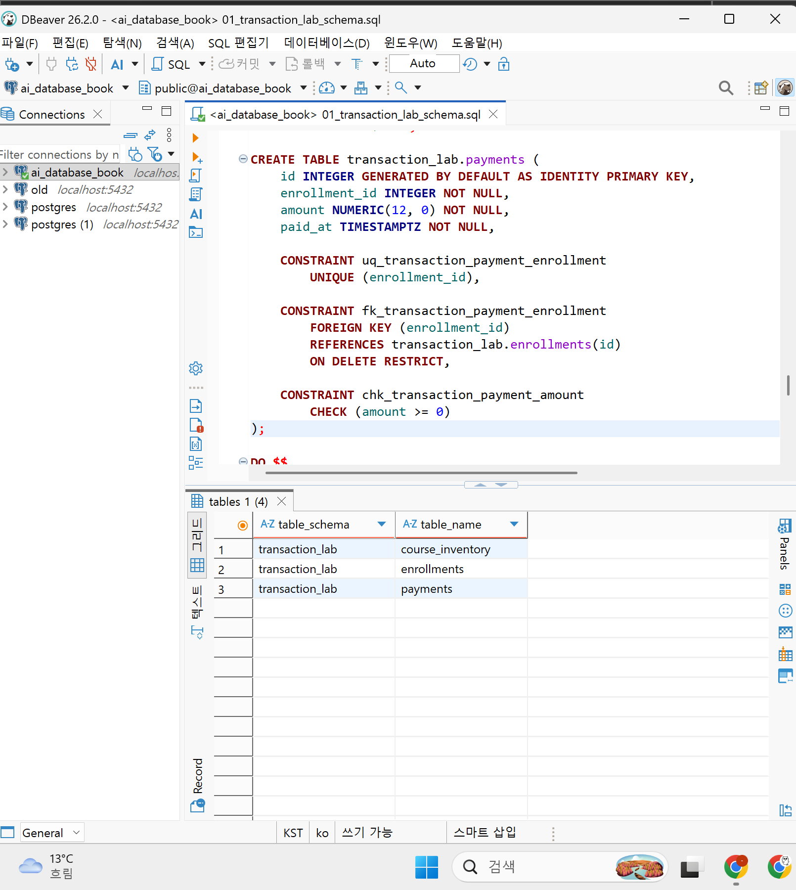
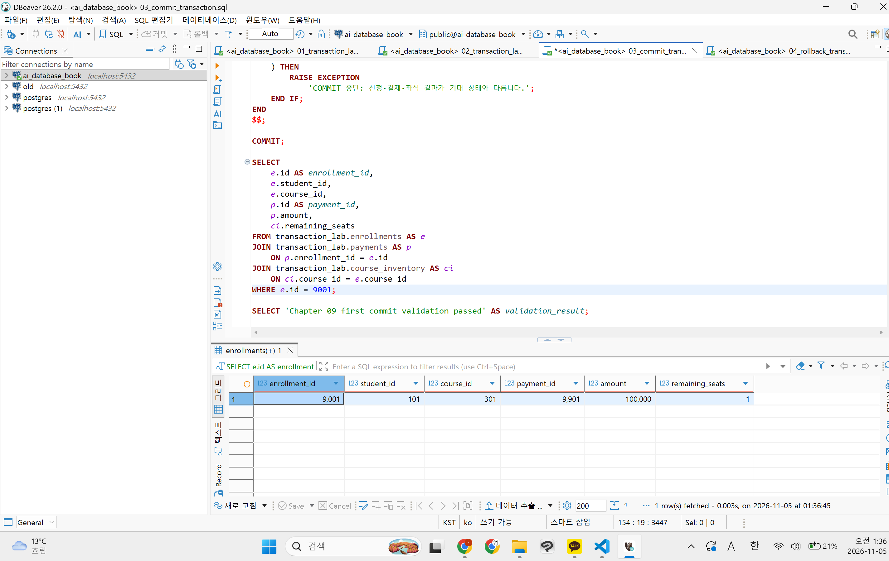
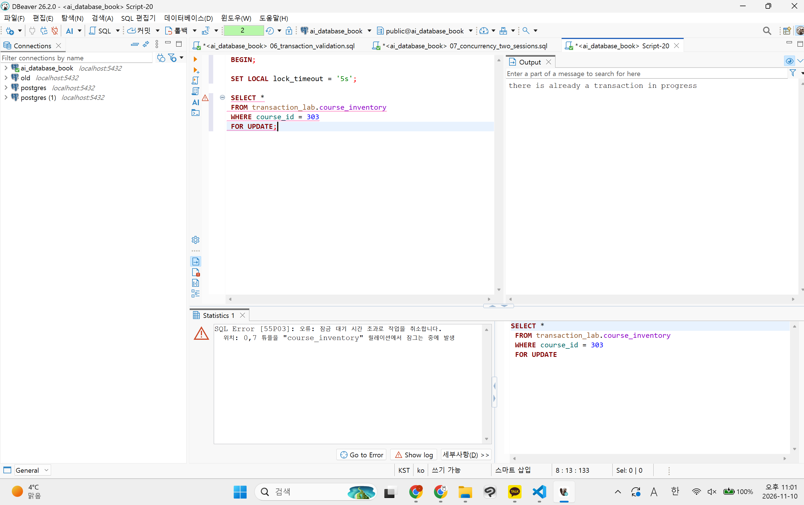

# Chapter 09 확장 실습 답안 템플릿

> **과제:** 트랜잭션으로 데이터 정합성 지키기  
> **사용 방법:** 이 파일을 내려받아 본인의 GitHub 저장소에 `chapter09_answer.md`라는 이름으로 저장한 뒤 실습하면서 바로 작성합니다.  
> **제출 방법:** LMS에는 파일을 직접 업로드하지 않고, **본인 GitHub 저장소의 `chapter09_answer.md` 파일 URL**을 제출합니다.

---

## 제출 전 주의

이 파일과 캡처 화면에는 실제 비밀번호, 전체 DB 접속 URL, API Key, 개인정보를 기록하지 않습니다.

```text
GitHub 계정 또는 별칭: 0524youna 
과제 작성일: 26/11/04
사용한 AI 도구: CLAUDE
```

---

# 1. 시작 환경과 Chapter 07·08 기준 상태 확인

다음을 실행하거나 Chapter 09의 `01_transaction_lab_schema.sql` 사전 검사를 확인합니다.

```sql
SELECT current_database();
SELECT current_user;
SELECT current_schema();
SHOW search_path;
SHOW transaction_read_only;
```

| 확인 항목 | 실제 결과 | 의미 |
| --- | --- | --- |
| `current_database()` | `ai_database_book` | 지금 접속한 DB |
| `current_user` | `postgres` | postgres 계정으로 접속 중임 |
| `current_schema()` | `public` | 스키마 생략 시 public에 테이블이 만들어짐 |
| `search_path` | `public, "$user"` | 테이블 이름만 쓰면 public부터 찾음 |
| `transaction_read_only` | `off` | 읽기 전용이 아니라 CRUD 실행 가능 |

Chapter 07·08 기준값:

```text
students = 3
instructors = 2
courses = 3
enrollments = 5
전체 recorded_amount = 590000
활성 = 3 / 340000
취소 제외 = 4 / 440000
```

### 기준 상태가 다르면 Chapter 09를 계속 진행하면 안 되는 이유

```text
기준 상태가 다른 채 진행하면 실습 결과가 달라질 수 있고 실패가 트랜잭션 문제인지 이전 chapter 상태 문제인지 구분하기 어려워짐. 
```

---

# 2. `transaction_lab` 스키마 생성

실행 파일:

```text
code/chapter09/01_transaction_lab_schema.sql
```

## 2-1. 생성 전 예상

```text
생성될 스키마: transaction_lab
생성될 테이블 3개: course_inventory, enrollments, payments

course_inventory 한 행의 의미: 특정 강의의 좌석 상태 한 건
enrollments 한 행의 의미: transaction_lab에서 생성한 수강신청 사건 한 건
payments 한 행의 의미: 특정 lab enrollment에 연결된 결제기록 한 건
```

## 2-2. 생성 결과

```text
통과 메시지: Chapter 09 transaction lab schema validation passed
조회 결과: transaction_lab에 course_inventory, enrollments, payments 3개 테이블 생성 확인
```

기대 메시지:

```text
Chapter 09 transaction lab schema validation passed
```

### Chapter 07·08의 `course_project`와 별도 `transaction_lab`을 사용하는 이유

```text
COMMIT·ROLLBACK 실습 중 기준 데이터(course_project)가 바뀌지 않도록 보호하기 위해서다.
실습 공간을 분리하면 실패해도 transaction_lab만 지우고 다시 만들 수 있다.
course_project는 외래키로 참조만 하므로 기준 상태(3/2/3/5, 590000)는 그대로 유지된다.
```

### 증거 화면

권장 경로:

```text
assignments/chapter09/images/step02_schema.png
```



---

# 3. 초기 좌석과 기준 데이터 입력

실행 파일:

```text
code/chapter09/02_transaction_lab_seed.sql
```

## 3-1. 실행 전 예상

```text
course 301 remaining_seats 예상: 2 (capacity 2)
course 302 remaining_seats 예상: 1 (capacity 1)
course 303 remaining_seats 예상: 1 (capacity 1)
lab enrollments 예상 행 수: 0
payments 예상 행 수: 0
```

## 3-2. 실제 결과

```text
course 301 remaining_seats:2
course 302 remaining_seats:1
course 303 remaining_seats:1
lab enrollments 행 수:0
payments 행 수:0
통과 메시지:Chapter 09 transaction lab seed validation passed
```

기대 초기 상태:

```text
course 301 / 302 / 303 remaining_seats = 3 / 0 / 0
lab enrollments = 0
payments = 0
```

### 예상과 실제가 다른 경우 원인

```text
템플릿의 기대값(3/0/0)과 실제값(2/1/1)이 다르다.
원인은 템플릿 기대값의 오기로 판단한다.
- seed SQL은 (301, 2, 2), (302, 1, 1), (303, 1, 1)을 INSERT한다.
- SQL 내부 검증도 2/1/1일 때만 통과하며, 실제로 통과 메시지가 출력됐다.
- 7번 최종 기대값(301=1, 302=0, 303=1)도 2/1/1에서 시작해야 맞는다.
  (9001: 301을 2→1, 9002: 302를 1→0, 303은 변경 없이 1)
따라서 실제 결과 2/1/1이 올바른 초기 상태다.
```

---

# 4. 첫 번째 정상 COMMIT 추적

실행 파일:

```text
code/chapter09/03_commit_transaction.sql
```

이 실습은 학생 101이 강의 301을 신청하는 하나의 업무 단위를 추적합니다.

## 4-1. 업무 단위 정의

```text
이 트랜잭션에서 함께 성공해야 하는 변경 1: course 301 좌석을 1개 확보한다.
변경 2: 학생 101의 lab enrollment를 만든다. (9001, 수강중, 100000)
변경 3: 해당 enrollment의 payment를 만든다. (9901, 100000)

하나라도 실패하면 전체를 취소해야 하는 이유: 세 변경이 하나의 업무라서 함께 성공해야 한다.
일부만 반영되면 좌석·신청·결제가 서로 맞지 않게 된다.
- 좌석만 줄고 신청이 없으면 → 아무도 안 쓰는 좌석이 사라진다.
- 신청만 있고 결제가 없으면 → 돈을 안 낸 수강생이 생긴다.
```

## 4-2. 상태 변화 기록

| 시점 | course 301 남은 좌석 | lab enrollment 9001 | payment 9901 | 설명 |
| --- | ---: | --- | --- | --- |
| BEGIN 전 | 2 | 없음 | 없음 | seed 직후 초기 상태 |
| 트랜잭션 내부 | 1 | 생성 (미확정) | 생성 (미확정) | 현재 세션에서만 보이고, 301 행은 FOR UPDATE로 잠김 |
| COMMIT 후 | 1 | 존재 (101/301/수강중/100000) | 존재 (9001/100000) | 확정되어 다른 세션에서도 보임 |

## 4-3. COMMIT 조건

```text
좌석 UPDATE 기대 영향 행 수: 1
실제 영향 행 수: 1
신청 생성 기대 행 수: 1
결제 생성 기대 행 수: 1
recorded_amount와 payment.amount 일치 여부: 일치 (100000 = 100000)
최종 COMMIT 판단: 검증 블록 통과 → COMMIT
통과 메시지: Chapter 09 first commit validation passed
```

기대 메시지:

```text
Chapter 09 first commit validation passed
```

### SQL 오류가 없었다는 사실만으로 COMMIT하면 안 되는 이유

```text
조건에 맞는 행이 없으면 UPDATE는 0행만 바꾸고 오류 없이 끝난다.
따라서 영향 행 수와 좌석·신청·결제 값이 기대대로인지 확인한 뒤 COMMIT해야 한다.
```

### 증거 화면

권장 경로:

```text
assignments/chapter09/images/step04_commit.png
```



---

# 5. ROLLBACK으로 전체 원상복구 확인

실행 파일:

```text
code/chapter09/04_rollback_transaction.sql
```

## 5-1. ROLLBACK 전 예상

```text
트랜잭션 안에서 임시로 바뀔 값:
- course 302 좌석 1 → 0
- 신청 9002 생성 (학생 102 / 강의 302 / 수강중 / 120000)
- 결제 9902 생성 (신청 9002 / 120000)
ROLLBACK 후 다시 돌아와야 할 값:
- course 302 좌석 1, 9002·9902 없음
이미 이전 파일에서 COMMIT된 9001/9901은 유지되어야 하는가:
- 유지되어야 한다. ROLLBACK은 현재 트랜잭션의 변경만 취소하고, 이미 COMMIT된 데이터는 건드리지 않는다.
```

## 5-2. 실제 결과

```text
ROLLBACK 후 course 301 상태: remaining_seats 1 
ROLLBACK 후 lab enrollments 행 수: 1 
ROLLBACK 후 payments 행 수: 1 
9001 존재 여부: o
9901 존재 여부: o
통과 메시지:Chapter 09 rollback validation passed
```

기대 메시지:

```text
Chapter 09 rollback validation passed
```

## 5-3. ROLLBACK과 IDENTITY

```text
ROLLBACK이 테이블 행 변경을 되돌리는 방식:
트랜잭션 안의 INSERT·UPDATE를 확정하지 않고 버린다.


IDENTITY 자동 번호가 반드시 이전 값으로 되돌아가지는 않는 이유: 이미 할당된 번호가 다시 회수되지 않을 수 있음.
IDENTITY는 시퀀스로 번호를 발급하는데, 시퀀스는 동시성을 위해 트랜잭션과 별개로 동작해 ROLLBACK돼도 되돌리지 않는다.


번호가 건너뛰었다고 데이터 손상이라고 단정할 수 없는 이유: ID의 역할은 행을 고유하게 식별하는 것이지 한 번도 빠지지 않는 업무 순번이 아니기 때문에.
손상 여부는 번호가 아니라 좌석·신청·결제 값이 서로 맞는지로 판단해야 한다.
```

---

# 6. 두 번째 COMMIT과 좌석 부족 0행 관찰

실행 파일:

```text
code/chapter09/05_commit_and_sold_out.sql
```

## 6-1. 두 번째 정상 COMMIT

```text
생성된 enrollment id:9002
학생 id:103
course id:302
recorded_amount:120000
payment id:9902
payment amount:120000
```

## 6-2. 좌석 부족 시도

```text
좌석 확보 UPDATE 기대 영향 행 수: 0 
실제 영향 행 수: 0
후속 enrollment 생성 행 수: 0 
후속 payment 생성 행 수: 0 
→ 9003·9903 미생성 확인 후 ROLLBACK
통과 메시지: Chapter 09 sold-out validation passed
```

기준상 좌석 부족 시 생성되지 않아야 하는 ID:

```text
9003
9903
```

### `UPDATE 0`이 SQL 실패가 아니라 업무상 실패일 수 있는 이유

```text
조건부 업데이트가 남은 좌석이 있을 때만 감소이면 좌석이 없는 경우 update는 0. 그러나 업무적으로는 신청실패임.
SQL 문법·제약조건 위반이 없으니 DB는 오류를 내지 않는다.
따라서 영향 행 수를 직접 확인해서 성공/실패를 판단해야 한다.
```

### 영향 행 수가 0인데 신청과 결제를 계속 생성하면 어떤 정합성 문제가 생기나요?

```text
좌석이 확보되지 않았는데 신청과 결제만 존재할 수 있음.
- 정원 1인 302에 수강중 신청이 2건이 되어 정원을 초과한다.
- 수강중 신청 수와 capacity - remaining_seats가 맞지 않게 된다.
- 좌석 없는 강의에 결제가 발생해 환불 문제가 생긴다.
```

---

# 7. 주 실습 최종 정합성 검증

실행 파일:

```text
code/chapter09/06_transaction_validation.sql
```

## 7-1. lab 최종 상태

| 항목 | 기대값 | 실제값 | 일치? |
| --- | ---: | ---: | --- |
| course_inventory 행 수 | 3 | 3 | o |
| lab enrollments 행 수 | 2 | 2 | o |
| payments 행 수 | 2 | 2 | o |
| course 301 remaining | 1 | 1 | o |
| course 302 remaining | 0 | 0 | o |
| course 303 remaining | 1 | 1 | o |

## 7-2. 주요 행

```text
9001 = student 101 / course 301 / amount 100000 / payment 9901
실제: 위와 일치한다.

9002 = student 103 / course 302 / amount 120000 / payment 9902
실제: 위와 일치한다. 

9003·9903 = 존재하지 않아야 함
실제: 존재하지 않음. 
```

## 7-3. 보호 대상 확인

```text
course_project.enrollments 행 수: 5
전체 recorded_amount:590,000
활성 건수/금액: 3/ 340,000
취소 제외 건수/금액: 4/ 440,000
```

기대값:

```text
course_project.enrollments = 5
전체 = 590000
활성 = 3 / 340000
취소 제외 = 4 / 440000
```

최종 기대 메시지:Chapter 09 main transaction validation passed

```text
Chapter 09 main transaction validation passed
```

### transaction_lab 실습 후에도 course_project 기준 상태를 다시 검사하는 이유

```text
격리된 실습이 기존 프로젝트 데이터를 손상하지 않았음을 검증해야 하기 때문에 새 실습 상태가 맞고 기존 프로젝트 상태가 그대로인 것을 확인해야함. 
```

---

# 8. ACID를 이번 실습으로 설명

교과서 정의를 그대로 복사하지 말고 이번 좌석·신청·결제 사례로 작성합니다.

```text
Atomicity: 좌석 감소 + 신청 생성 + 결제 생성 -> 모두 반영되거나 모두 취소 

Consistency: 트랜젝션 전후 상태가 이번 프로젝트의 규칙을 만족해야 함. 예를 들어 remaining_seats >=0이고 신청 금액 = payment 금액이어야 함. 

Isolation: 동시에 여러 사용자가 마지막 좌석을 신청할 때 서로의 작업이 정해진 방식으로 조정되어야 함. 

Durability: Commit된 9001/9901같은 결과는 트랜잭션 완료 후 확정 상태로 유지 .
```

### Atomicity와 Consistency가 같은 뜻이 아닌 이유

```text
Atomicity가 있다고 해서 업무 내용이 자동을 맞게 되는 것은 아님. 잘못된 SQL 세 개를 한 트랜잭션으로 묶어 Commit하면 세 개가 모두 잘못된 상태로 확정될 수도 있음. 전후 상태가 규칙을 만족하지 못할 수도 있음. 
```

---

# 9. 선택 실습 — 두 세션 Lock 대기 관찰

실행 파일:

```text
code/chapter09/07_concurrency_two_sessions.sql
```

가능하면 DBeaver에서 **서로 다른 두 연결 세션**으로 수행합니다.

## 9-1. 내 환경

```text
실제 두 세션 실습 수행 / 절차 분석만 수행: 실제 두 세션 실습 수행 (DBeaver 편집기 2개, 서로 다른 연결)
transaction_isolation: read committed (PostgreSQL 기본값, 파일도 이 기준으로 설명)
lock_timeout: 기본 0(무기한 대기). 세션 B에서만 SET LOCAL lock_timeout = '5s'로 5초 제한
```

## 9-2. 시간 순서 기록

| 순서 | Session A | Session B | 관찰 |
| ---: | --- | --- | --- |
| 1 | `BEGIN;` 후 course 303을 `SELECT ... FOR UPDATE` | - | A가 303 행 잠금 획득. remaining_seats = 1 조회 |
| 2 | (COMMIT하지 않고 유지) | `BEGIN; SET LOCAL lock_timeout = '5s';` 후 같은 303 행 `SELECT ... FOR UPDATE` | B는 결과가 나오지 않고 대기. 5초 후 `SQL Error [55P03]: 오류: 잠금 대기 시간 초과로 작업을 취소합니다. 위치: 0,7 튜플을 "course_inventory" 릴레이션에서 잠그는 중에 발생` |
| 3 | - | `ROLLBACK;` | 오류로 aborted 상태가 된 B 트랜잭션 종료 |
| 4 | `ROLLBACK;` (변경 없이 잠금만 관찰) | - | A의 잠금 해제. 이후 B에서 다시 조회하면 대기 없이 최신 값(remaining_seats = 1)을 봄 |

```text
먼저 Lock을 획득한 세션: Session A
대기한 세션: Session B (5초 대기 후 lock timeout 오류 55P03)
A가 COMMIT/ROLLBACK한 뒤 B에서 일어난 일: A가 잠금을 유지하는 동안 B는 5초를 넘겨 타임아웃으로 취소됨.
  A가 ROLLBACK해 잠금을 푼 뒤에는 B가 대기 없이 303 행의 최신 값(remaining_seats = 1)을 조회할 수 있음.
  (A가 5초 안에 끝났다면 B는 오류 없이 대기가 풀려 바로 결과를 받았을 것)
  선택 확장처럼 A가 좌석을 차감하고 COMMIT했으면 B는 0을 보게 되고 후속 신청을 실행하지 않아야 함.
```

### Lock 대기와 Deadlock의 차이

```text
Lock 대기: B가 A의 잠금 해제를 한쪽 방향으로 기다리는 상태. A가 COMMIT/ROLLBACK하면 자연스럽게 풀림.
Deadlock: A는 B가 잠근 행을, B는 A가 잠근 행을 서로 기다리는 순환 대기.
  (서로 다른 행을 반대 순서로 잠글 때 발생) 누구도 먼저 끝날 수 없어서
  PostgreSQL이 감지해 한쪽 트랜잭션을 오류로 끝내야 풀림.
```

### `SELECT ... FOR UPDATE`가 모든 UPDATE 앞에 항상 필요한 것은 아닌 이유

```text
UPDATE ... WHERE remaining_seats > 0 RETURNING 같은 단일 조건부 UPDATE도 수정 대상 행의 잠금을 스스로 획득하고,
조건 검사와 변경을 한 문장에서 처리함. 영향 행 수만 확인하면 좌석 확보 성공 여부를 알 수 있음.
FOR UPDATE는 잠근 상태를 먼저 읽고 그 값으로 여러 후속 판단(신청·결제 생성 등)을 이어갈 때 특히 필요함.
```

### 증거 화면

실제 수행했다면 권장 경로:

```text
assignments/chapter09/images/step09_lock.png
```



---

# 10. 선택 실습 — 취소와 좌석 복구

실행 파일:

```text
code/chapter09/08_cancel_and_restore.sql
```

```text
9001 취소 성공 행 수: 1 (status 수강중 → 취소)
course 301 좌석 변화: remaining_seats 1 → 2 (capacity 2)
같은 취소를 다시 시도한 행 수: 0 (repeated_cancel_count = 0)
두 번째 좌석 복구 행 수: 0 (repeated_restore_count = 0)
payment 9901 유지 여부: 유지 (9901 / 100000. 환불은 이번 장 범위가 아니라 결제 기록을 그대로 둠)
최종 ROLLBACK 후 원상복구 여부: 복구됨. 9001 수강중 / 301 remaining 1 / enrollments 2행, payments 2행
통과 메시지: Chapter 09 cancel rollback validation passed
```

기대 흐름:

```text
9001 수강중 → 취소 1행
course 301 remaining 1 → 2
같은 취소 재시도 → 0행
추가 좌석 복구 → 0행
마지막 ROLLBACK → 주 실습 기준으로 복구
```

### 같은 취소를 두 번 처리해도 좌석이 두 번 증가하지 않아야 하는 이유

```text
취소된 신청은 한 건인데 좌석이 두 번 늘어나면 실제 수강중 신청 수와 남은 좌석이 맞지 않게 된다.
(capacity - remaining_seats ≠ 수강중 신청 수, 정원보다 많이 팔릴 수 있음)
그래서 좌석 복구는 "수강중 → 취소" 상태 변경에 실제로 성공한 행(cancelled CTE)만 입력으로 사용한다.
재시도하면 이미 취소 상태라 cancelled가 0행이 되고, 좌석 복구도 0행이 된다.
또 remaining_seats < capacity 조건이 정원을 넘는 복구를 한 번 더 막는다.
```

---

# 11. 선택 실습 — 오류 상태와 SAVEPOINT

실행 파일:

```text
code/chapter09/09_error_and_savepoint.sql
```

## 11-1. 일반 오류 후 트랜잭션 상태

```text
발생시킨 오류: 학생 101이 이미 수강중인 강의 301에 활성 신청 9003을 한 번 더 INSERT
  → uq_transaction_enrollments_active 고유 제약 위반 (duplicate key value violates unique constraint)
오류 이후 다음 SQL 실행 결과: 어떤 SQL을 실행해도
  "current transaction is aborted, commands ignored until end of transaction block" 오류가 나고 실행되지 않음
전체 ROLLBACK이 필요한 이유: 오류 후 트랜잭션은 aborted 상태라 COMMIT할 수 없고(COMMIT해도 ROLLBACK으로 처리됨),
  앞에서 한 좌석 차감도 확정하면 안 되므로 ROLLBACK으로 끝내야 다시 정상 상태로 SQL을 실행할 수 있음
```

## 11-2. SAVEPOINT 사용

```text
SAVEPOINT 이름: before_duplicate_enrollment
오류 발생 위치: SAVEPOINT 이후 course 301 좌석을 1 → 0으로 임시 차감한 다음,
  중복 활성 신청 9003 INSERT에서 uq_transaction_enrollments_active 오류 발생
ROLLBACK TO SAVEPOINT 후 상태: SAVEPOINT 이후 변경이 모두 취소됨.
  course 301 remaining_seats = 1, enrollment 9003 = 0행
이후 계속 실행할 수 있었는가: 예. aborted 상태가 풀려 SELECT 등 다음 SQL을 실행할 수 있었고,
  RELEASE SAVEPOINT 후 마지막에 ROLLBACK으로 트랜잭션을 종료함
```

### SAVEPOINT가 전체 ROLLBACK과 다른 점

```text
전체 ROLLBACK은 BEGIN 이후 모든 변경을 취소하고 트랜잭션을 끝낸다.
ROLLBACK TO SAVEPOINT는 SAVEPOINT 이후 변경만 취소하고, 트랜잭션은 계속 열려 있어
SAVEPOINT 이전 작업을 유지한 채 다음 SQL을 이어서 실행할 수 있다.
단, 마지막에 COMMIT 또는 ROLLBACK으로 전체 트랜잭션을 따로 끝내야 한다.
```

---

# 12. 개인 프로젝트 트랜잭션 시나리오 설계

Chapter 07에서 시작한 개인 프로젝트를 사용합니다.

개인 프로젝트: 영화 예매 서비스 (Chapter 07 11~12번, Chapter 08 12번 질문 P08-Q01~Q03)

둘 이상의 변경이 함께 성공해야 하는 업무를 **하나** 선택합니다.

예:

```text
예약 생성 + 좌석 차감
주문 생성 + 재고 차감
대여 생성 + 대여 가능 상태 변경
답변 등록 + 질문 상태 변경
```

## 12-1. 업무 정의

```text
시나리오 ID: P09-T01
업무 이름: 영화 좌석 예매 (예매 생성 + 좌석별 BOOKED 기록 생성)
사용자 행동: 관객(user_id = 1)이 회차 10번에서 좌석 2개(screening_seat_id 101, 102)를 골라 예매 버튼을 누른다.
왜 하나의 트랜잭션이어야 하는가: 예매(reservations) 1행과 좌석 예매 기록(reservation_seats) 2행이 함께 성공해야 한다.
  예매만 생기고 좌석 기록이 없으면 "좌석 없는 예매"가 남는다 (P07-MR08 위반).
  좌석 2개 중 1개만 BOOKED가 되면 사용자가 원하지 않은 부분 예매가 된다.
  그래서 하나라도 실패하면 전체를 ROLLBACK해서 예매 전 상태로 되돌려야 한다.
Chapter 08과의 연결: 이 트랜잭션이 COMMIT되면 P08-Q01(회차별 남은 좌석 수)의 회차 10 결과가 2 줄고,
  P08-Q02(영화별 예매 좌석 수·금액)와 P08-Q03(사용자별 예매 건수)도 함께 바뀐다.
  ROLLBACK되면 세 질문의 결과가 BEGIN 전과 같아야 한다.
```

## 12-2. 트랜잭션 설계표

| 항목 | 내 설계 |
| --- | --- |
| BEGIN 전 확인 상태 | 회차 10번이 있고, 좌석 101·102가 회차 10번 소속이며 AVAILABLE이고, 두 좌석에 BOOKED 기록이 없다. P08-Q01로 회차 10의 remaining_seat_count를 기록해 둔다 (예: N) |
| 잠금/경쟁 가능 데이터 | screening_seats의 101·102 행 (`SELECT ... FOR UPDATE`로 잠금). 다른 관객이 같은 좌석을 동시에 예매할 수 있음 |
| 변경 1 | `reservations`에 예매 1행 INSERT (user_id = 1, screening_id = 10) → `RETURNING reservation_id` |
| 기대 영향 행 수 | 1행 |
| 변경 2 | `reservation_seats`에 좌석 101·102의 BOOKED 기록 INSERT. 가격은 회차 가격을 `price_at_booking`에 복사. AVAILABLE이고 BOOKED 기록이 없는 좌석만 넣도록 `INSERT ... SELECT ... WHERE`로 작성 |
| 기대 영향 행 수 | 2행 (요청한 좌석 수와 같아야 함) |
| 추가 변경 | 없음. ScreeningSeats에는 예매 여부를 저장하지 않으므로 좌석 상태 UPDATE가 없음 (P07-MD02) |
| COMMIT 전 검증 | ① 이번 예매의 BOOKED 좌석 수 = 2 ② 좌석 101·102의 BOOKED 기록이 각각 1개 ③ 좌석의 회차와 예매의 회차가 같음 (10) ④ P08-Q01 회차 10 남은 좌석 = N - 2 |
| COMMIT 조건 | 변경 1이 1행, 변경 2가 2행이고 검증 ①~③을 모두 통과 |
| ROLLBACK 조건 | 변경 2가 2행보다 적음(이미 팔렸거나 BLOCKED 좌석), BOOKED 부분 고유 인덱스 위반 오류, FK/CHECK 오류, 검증 실패 중 하나라도 발생 |

## 12-3. 실패 시나리오

최소 두 개 작성합니다.

```text
실패 1: 좌석 102가 그 사이에 다른 관객에게 팔림 (이미 BOOKED 기록이 있음)
어느 단계에서 발생: 변경 2 (reservation_seats INSERT). 조건부 INSERT라 101만 들어가서 영향 행 수가 2가 아니라 1이 됨
  (조건 없이 INSERT하면 BOOKED 부분 고유 인덱스 위반 오류가 남)
남으면 안 되는 부분 상태: 예매 1행 + 좌석 101 BOOKED 1행만 있는 부분 예매
ROLLBACK 후 기대 상태: 이번 예매 행과 좌석 101 기록이 모두 없음. reservations·reservation_seats 행 수가 BEGIN 전과 같고 좌석 101은 다시 예매 가능

실패 2: 좌석 102가 관리자에 의해 BLOCKED 처리됨 (또는 다른 회차의 좌석 ID를 보냄)
어느 단계에서 발생: 변경 2의 조건(AVAILABLE, screening_id = 10)에서 102가 걸러져 1행만 INSERT됨
  → 영향 행 수 검증에서 실패
남으면 안 되는 부분 상태: 좌석 기록이 1개뿐인 예매, 또는 다른 회차 좌석이 섞인 예매
ROLLBACK 후 기대 상태: 이번 예매 관련 행 0건. 좌석 101은 계속 AVAILABLE이고 BOOKED 기록 없음

실패 3 (추가): 존재하지 않는 user_id로 예매
어느 단계에서 발생: 변경 1 (reservations INSERT)에서 FK 위반 오류
남으면 안 되는 부분 상태: 없음(첫 단계에서 실패). 오류 후 트랜잭션은 aborted 상태가 되어 이후 SQL이 실행되지 않음
ROLLBACK 후 기대 상태: 모든 테이블 행 수가 BEGIN 전과 같음
```

## 12-4. SQL 초안

```sql

-- 예: user_id = 1, screening_id = 10, 좌석 screening_seat_id = 101, 102

BEGIN;

-- 0) BEGIN 직후 상태 확인 + 경쟁 좌석 잠금
--    같은 좌석을 동시에 예매하려는 다른 트랜잭션은 여기서 대기함
SELECT ss.screening_seat_id, ss.screening_id, ss.availability_status
FROM screening_seats AS ss
WHERE ss.screening_seat_id IN (101, 102)
  AND ss.screening_id = 10
ORDER BY ss.screening_seat_id      -- 항상 같은 순서로 잠가 교착 상태 줄이기
FOR UPDATE;
-- 기대: 2행, 모두 AVAILABLE

-- 1) 변경 1: 예매 생성 (기대 1행)
INSERT INTO reservations (user_id, screening_id, reserved_at)
VALUES (1, 10, now())
RETURNING reservation_id;          -- 예: 501

-- 2) 변경 2: 좌석별 BOOKED 기록 생성 (기대 2행)
--    AVAILABLE이고, 이 회차 소속이고, 아직 BOOKED 기록이 없는 좌석만 INSERT
INSERT INTO reservation_seats (reservation_id, screening_seat_id, status, price_at_booking)
SELECT 501, ss.screening_seat_id, 'BOOKED', sc.price
FROM screening_seats AS ss
JOIN screenings AS sc
  ON sc.screening_id = ss.screening_id
WHERE ss.screening_seat_id IN (101, 102)
  AND ss.screening_id = 10
  AND ss.availability_status = 'AVAILABLE'
  AND NOT EXISTS (
        SELECT 1
        FROM reservation_seats AS rs
        WHERE rs.screening_seat_id = ss.screening_seat_id
          AND rs.status = 'BOOKED'
  );
-- 기대: INSERT 0 2  → 2가 아니면 아래 검증 없이 ROLLBACK

-- 3) COMMIT 전 검증
SELECT COUNT(*) AS booked_seats            -- 기대: 2
FROM reservation_seats
WHERE reservation_id = 501
  AND status = 'BOOKED';

SELECT rs.screening_seat_id, COUNT(*) AS booked_count   -- 기대: 각 1
FROM reservation_seats AS rs
WHERE rs.screening_seat_id IN (101, 102)
  AND rs.status = 'BOOKED'
GROUP BY rs.screening_seat_id;

SELECT COUNT(*) AS mismatched_rows         -- 기대: 0
FROM reservation_seats AS rs
JOIN reservations AS r ON r.reservation_id = rs.reservation_id
JOIN screening_seats AS ss ON ss.screening_seat_id = rs.screening_seat_id
WHERE rs.reservation_id = 501
  AND r.screening_id <> ss.screening_id;

-- ④ Chapter 08 P08-Q01 재사용: 회차 10 남은 좌석 (기대: BEGIN 전 N → N - 2)
SELECT
    sc.screening_id,
    COUNT(ss.screening_seat_id) FILTER (
        WHERE ss.availability_status = 'AVAILABLE'
          AND rs.reservation_seat_id IS NULL
    ) AS remaining_seat_count
FROM screenings AS sc
LEFT JOIN screening_seats AS ss
    ON sc.screening_id = ss.screening_id
LEFT JOIN reservation_seats AS rs
    ON ss.screening_seat_id = rs.screening_seat_id
   AND rs.status = 'BOOKED'
WHERE sc.screening_id = 10
GROUP BY sc.screening_id;

-- 4) 판단
COMMIT;      -- 변경 1 = 1행, 변경 2 = 2행, 검증 모두 통과한 경우
-- ROLLBACK; -- 영향 행 수가 다르거나, 오류가 났거나, 검증이 하나라도 실패한 경우
```

```text
예상 결과: COMMIT 시 reservations +1행, reservation_seats +2행, 회차 10 남은 좌석 N → N - 2.
  P08-Q02의 해당 영화 booked_seat_count +2, P08-Q03의 user 1 reservation_count +1.
  ROLLBACK 시 위 값이 모두 BEGIN 전과 같음.
실제 결과: 미실행 (개인 프로젝트 테이블 아직 없음)
검산 결과: 미실행. BEGIN 전·COMMIT 후·ROLLBACK 후에 P08-Q01~Q03을 실행해 비교할 예정.
```

---

# 13. AI를 트랜잭션 리뷰어로 활용

AI에게 완성 SQL부터 요구하지 않습니다.

## 13-1. 사용한 프롬프트

```text
영화 예매 서비스 개인 프로젝트(PostgreSQL)의 예매 트랜잭션을 리뷰해 주세요.
완성 SQL부터 주지 말고, 아래 항목을 먼저 검토한 뒤 마지막에 PostgreSQL 초안을 제안해 주세요.

테이블:
- screening_seats(screening_seat_id, screening_id, seat_id, availability_status: AVAILABLE / BLOCKED)
- reservations(reservation_id, user_id, screening_id, reserved_at)
- reservation_seats(reservation_seat_id, reservation_id, screening_seat_id,
  status: BOOKED / CANCELLED, price_at_booking >= 0)
- 한 회차 좌석의 BOOKED 기록은 최대 하나 (부분 고유 인덱스)
- 예매 여부는 screening_seats에 저장하지 않고 reservation_seats의 BOOKED 기록으로 판단함

업무: 사용자 1이 회차 10에서 좌석 101, 102를 한 번에 예매한다.

검토 요청:
1. 하나의 업무 단위가 어디까지인지
2. BEGIN 전 확인할 상태
3. 경쟁 가능 데이터와 잠금 필요성
4. 각 변경의 기대 영향 행 수
5. 여러 테이블 최종 정합성 검증
6. COMMIT 조건
7. ROLLBACK 조건
8. 동시 실행 위험
```

권장 질문 요소:

```text
1. 하나의 업무 단위가 어디까지인지
2. BEGIN 전 확인할 상태
3. 경쟁 가능 데이터와 잠금 필요성
4. 각 변경의 기대 영향 행 수
5. 여러 테이블 최종 정합성 검증
6. COMMIT 조건
7. ROLLBACK 조건
8. 동시 실행 위험
을 먼저 검토한 뒤 PostgreSQL 초안을 제안하도록 요청
```

## 13-2. AI 제안 검토

AI가 제안한 SQL 초안 (요약):

```sql
-- BEGIN 전에 빈 좌석 확인
SELECT screening_seat_id
FROM screening_seats
WHERE screening_seat_id IN (101, 102)
  AND availability_status = 'AVAILABLE';

BEGIN;
INSERT INTO reservations (user_id, screening_id, reserved_at)
VALUES (1, 10, now())
RETURNING reservation_id;

INSERT INTO reservation_seats (reservation_id, screening_seat_id, status, price_at_booking)
VALUES (501, 101, 'BOOKED', 12000),
       (501, 102, 'BOOKED', 12000);
-- 부분 고유 인덱스 위반 오류가 나면 ROLLBACK, 아니면 COMMIT
COMMIT;
```

| AI 제안 | 수용 / 수정 / 보류 / 거절 | 실제 또는 논리 검증 | 판단 이유 |
| --- | --- | --- | --- |
| 예매 1행 + 좌석 기록 N행을 하나의 업무 단위로 묶음 | 수용 | 논리 검증: 좌석 기록 없는 예매가 남으면 P07-MR08 위반 | 내 12-1 설계와 같음 |
| 빈 좌석 확인을 BEGIN **전에** 실행 | 수정 | 논리 검증: 확인 후 INSERT 전에 다른 세션이 같은 좌석을 예매할 수 있음 | BEGIN 안에서 `SELECT ... FOR UPDATE`로 잠그고 확인하도록 바꿈 |
| 좌석 확인에 BOOKED 기록 검사가 없음 | 수정 | 논리 검증: AVAILABLE은 판매 가능 여부일 뿐, 이미 팔린 좌석도 AVAILABLE임 (P07-MD02) | `NOT EXISTS (BOOKED 기록)` 조건 추가 |
| 회차 일치 조건 없음 (`screening_id = 10` 빠짐) | 수정 | 논리 검증: 다른 회차의 좌석 ID를 넣어도 통과함 | 조건과 COMMIT 전 회차 일치 검증(mismatched_rows = 0) 추가 |
| 가격을 `12000`으로 직접 입력 | 수정 | 논리 검증: 실제 회차 가격과 다를 수 있음 | 회차 가격을 `INSERT ... SELECT`로 복사 (P07-MD03). 단 가격 컬럼은 아직 미정 |
| 중복 예매는 부분 고유 인덱스 오류로만 막음 | 수정 | 논리 검증: BLOCKED 좌석·다른 회차 좌석은 오류 없이 INSERT됨 | 인덱스는 마지막 방어선으로 두고, 영향 행 수 2 확인 + 검증 쿼리 추가 |
| SERIALIZABLE 격리 수준 사용 | 보류 | 미실행 | 행 잠금(FOR UPDATE)으로 충분한지 먼저 확인하고, 직렬화 실패 시 재시도 로직이 필요해서 보류 |

### AI SQL에서 확인한 가장 중요한 위험

```text
빈 좌석 확인을 BEGIN 전에 잠금 없이 하는 것.
확인과 INSERT 사이에 다른 관객이 같은 좌석을 예매할 수 있다.
부분 고유 인덱스 덕분에 BOOKED 중복 자체는 오류로 막히지만,
BLOCKED 좌석·다른 회차 좌석은 오류 없이 들어가므로 인덱스만 믿으면 안 된다.
그래서 BEGIN 안에서 FOR UPDATE로 잠근 뒤, 조건부 INSERT의 영향 행 수와 검증 쿼리로 판단하도록 수정했다.
```

### “오류가 없으면 COMMIT”만으로 부족한 이유

```text
조건부 INSERT ... SELECT는 조건에 맞는 좌석이 1개뿐이어도 오류 없이 1행만 넣고 끝난다.
좌석 2개를 요청했는데 1개만 BOOKED된 부분 예매가 오류 없이 COMMIT될 수 있다.
따라서 영향 행 수(2), 이번 예매의 BOOKED 좌석 수, 회차 일치, P08-Q01 남은 좌석 수 변화를
직접 확인한 뒤 COMMIT해야 한다. (Chapter 09 6번의 UPDATE 0행과 같은 원리)
```

---

# 14. 최종 성찰

아래 문장은 본인의 말로 작성합니다.

```text
1. 트랜잭션은 여러 SQL을 단순히 묶는 것이 아니라
   좌석 확보·신청·결제처럼 함께 성공해야 하는 하나의 업무 단위를 모두 반영하거나 모두 취소하는 것 이다.

2. ROLLBACK이 필요한 대표 상황은
   좌석이 없어 UPDATE가 0행이거나, 오류가 나거나, 검증 결과가 기대와 달라 일부 변경만 남을 수 있는 경우 이다.

3. 조건부 UPDATE의 영향 행 수가 중요한 이유는
   조건에 맞는 행이 없으면 오류 없이 0행으로 끝나서, 영향 행 수로만 업무 성공/실패를 알 수 있기 때문 이다.

4. 제약조건이 있어도 트랜잭션이 필요한 이유는
   제약조건은 한 행·한 테이블 규칙만 막고, 좌석·신청·결제가 서로 맞는지 같은 여러 테이블의 부분 반영은 막지 못하기 때문 이다.

5. Lock이 필요한 이유는
   여러 사용자가 동시에 마지막 좌석을 신청할 때 한 세션이 끝날 때까지 다른 세션을 기다리게 해서 좌석이 두 번 팔리지 않게 하기 때문 이다.

6. AI가 만든 트랜잭션 SQL을 검토할 때 가장 먼저 확인할 것은
   상태 확인과 잠금이 BEGIN 안에 있는지, 그리고 영향 행 수와 검증 결과로 COMMIT/ROLLBACK을 판단하는지 이다.
```

---

# 15. 제출 체크리스트

- [x] `chapter09_answer.md`를 본인 저장소에 만들었다.
- [x] Chapter 07·08 기준 상태를 확인했다.
- [x] `transaction_lab` 스키마와 초기 데이터를 만들었다.
- [x] 정상 COMMIT의 전·중·후 상태를 기록했다.
- [x] ROLLBACK 후 부분 변경이 남지 않는지 확인했다.
- [x] ROLLBACK과 IDENTITY 번호의 차이를 설명했다.
- [x] 좌석 부족 시 영향 행 수 0을 관찰했다.
- [x] 영향 행 수 0일 때 후속 행이 생성되지 않음을 확인했다.
- [x] `06_transaction_validation.sql` 최종 검증을 통과했다.
- [x] `course_project`가 변경되지 않았음을 확인했다.
- [x] ACID를 이번 실습 사례로 설명했다.
- [x] Lock 실습 또는 두 세션 절차 분석을 수행했다.
- [x] 개인 프로젝트 트랜잭션 시나리오를 작성했다.
- [x] AI 제안의 COMMIT/ROLLBACK/영향 행 수 검증을 확인했다.
- [x] 핵심 캡처는 3~4장 정도로 정리했다.
- [x] 캡처에 비밀번호·개인정보가 없다.
- [x] GitHub 웹에서 Markdown과 이미지가 정상적으로 보인다.
- [x] 최종 파일을 commit/push했다.

---

# 16. LMS 제출 URL

아래 형식의 **본인 GitHub 파일 URL**을 LMS에 제출합니다.

```text
https://github.com/<본인-GitHub-ID>/<본인-저장소>/blob/main/assignments/chapter09/chapter09_answer.md
```

내 제출 URL:

```text
https://github.com/0524youna-gif/2602database/blob/main/assignments/chapter09/chapter09_answer.md
```

> 교수자 템플릿 URL, 저장소 메인 URL, Raw URL이 아니라 **작성 완료된 본인의 `chapter09_answer.md` 파일 화면 URL**을 제출합니다.
