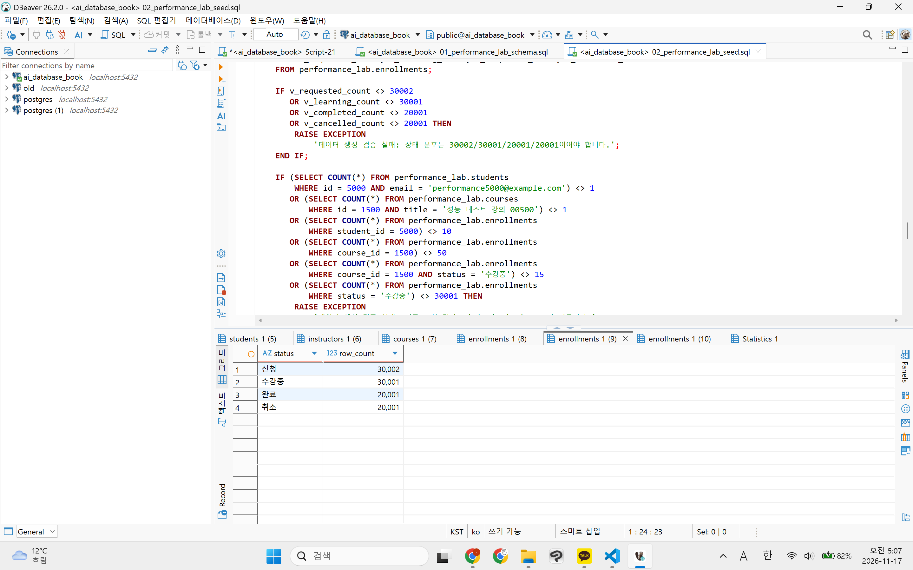
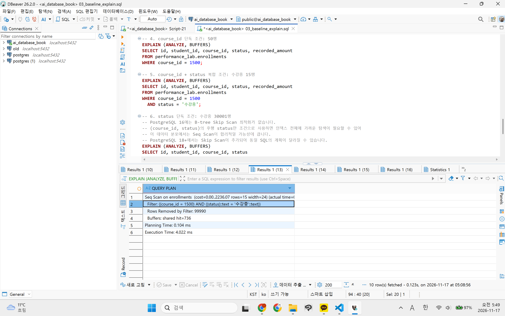
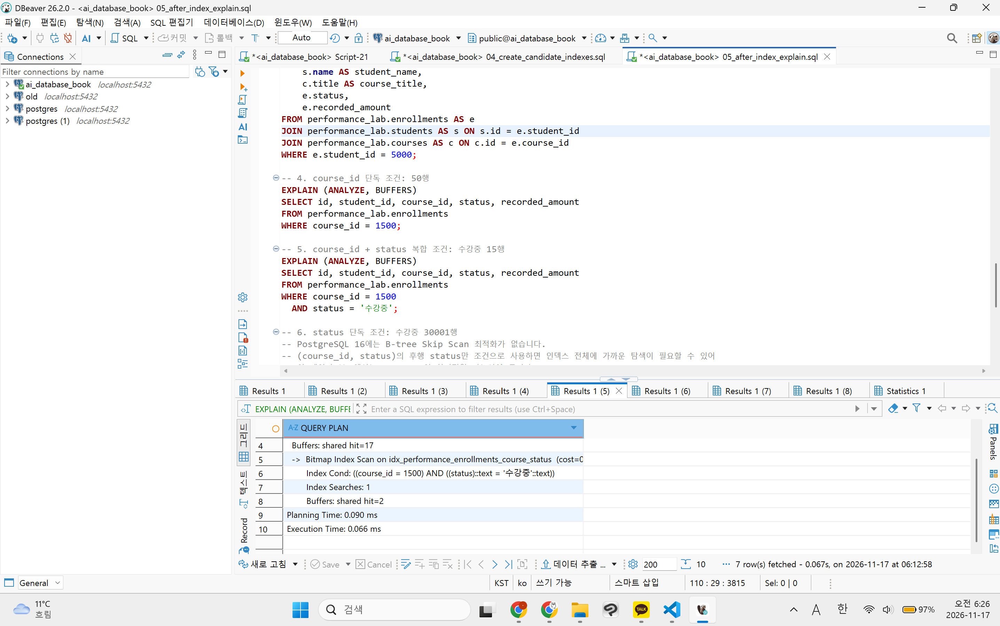

# Chapter 10 확장 실습 답안 템플릿

> **과제:** 실행 계획으로 인덱스 효과 검증하기  
> **사용 방법:** 이 파일을 내려받아 본인의 GitHub 저장소에 `chapter10_answer.md`라는 이름으로 저장한 뒤 실습하면서 바로 작성합니다.  
> **제출 방법:** LMS에는 파일을 직접 업로드하지 않고, **본인 GitHub 저장소의 `chapter10_answer.md` 파일 URL**을 제출합니다.

---

## 제출 전 주의

이 파일과 캡처 화면에는 실제 비밀번호, 전체 DB 접속 URL, API Key, 개인정보를 기록하지 않습니다.

```text
GitHub 계정 또는 별칭:0524-youna
과제 작성일:26/11/14
사용한 AI 도구:claude
```

---

# 1. PostgreSQL 버전과 시작 환경 확인

다음을 실행합니다.

```sql
SELECT version();
SELECT current_database();
SELECT current_user;
SELECT current_schema();
SHOW search_path;
```

| 확인 항목 | 실제 결과 | 의미 |
| --- | --- | --- |
| PostgreSQL 버전 |  PostgreSQL 18.6 on x86_64-windows, compiled by msvc-19.44.35228, 64-bit| 실행 계획 해석 기준 버전 (18+는 Skip Scan 가능) |
| `current_database()` |ai_database_book  | 실습 DB에 접속했는지 확인 (SQL 파일 보호 조건) |
| `current_user` |  postgres| 스키마 생성·인덱스 생성 권한이 있는 사용자 |
| `current_schema()` |  public| 기본 스키마. 실습 객체는 performance_lab.으로 한정해 사용하므로 무관 |
| `search_path` |  public, "$user"| 스키마 미지정 이름을 찾는 순서 |

### PostgreSQL 버전을 기록해야 하는 이유

```text
버전에 따라 동일한 데이터와 sql이라도 실행계획이 달라질 수 있으므로 내 계획이 본문 화면과 다르다고 해서 무조건 틀린게아니라 버젼을 확인해야 함. 
```

> 이 장의 자동 검증 기준은 PostgreSQL 16입니다. PostgreSQL 18 이상에서는 B-tree Skip Scan 등으로 동일 SQL의 실행 계획이 달라질 수 있습니다.

---

# 2. Chapter 07·08 기준 상태 확인

Chapter 10은 기존 `course_project`를 변경하지 않습니다.

확인 기준:

```text
students = 3
instructors = 2
courses = 3
enrollments = 5

전체 recorded_amount = 590000
활성 = 3건 / 340000
취소 제외 = 4건 / 440000
```

```text
1001 = 완료 / 100000
1004 = 취소 / 150000
1005 = 신청 / 120000
```

### 실제 확인 결과

```text
students:3
instructors:2
courses:3
enrollments:5
전체 recorded_amount:590000
활성 신청 건수/금액:3건 / 340000
취소 제외 건수/금액:4건 / 440000
```

### 성능 실험을 기존 `course_project`에 대량 데이터를 넣지 않고 별도 스키마에서 하는 이유

```text
chapter 07데이터는 적기 때문에 이정도 규모에서는 테이블 전체를 읽는 seq scan이 합리적일 수 있기 때문에 별도 스키마를 사용. 
```

---

# 3. `performance_lab` 생성과 대량 데이터 확인

다음 파일을 순서대로 실행합니다.

```text
code/chapter10/01_performance_lab_schema.sql
code/chapter10/02_performance_lab_seed.sql
```

## 3-1. 생성 후 행 수

| 테이블 | 기대 행 수 | 실제 행 수 | 일치? |
| --- | ---: | ---: | --- |
| `performance_lab.students` | 10003 |10003  |o  |
| `performance_lab.instructors` | 2 |2  |  o|
| `performance_lab.courses` | 2003 |2003  |o  |
| `performance_lab.enrollments` | 100005 |100005  |  o|

## 3-2. 데이터 분포 확인

| 조건 | 기대 행 수 | 실제 행 수 | 대략적 비율 |
| --- | ---: | ---: | ---: |
| `performance5000@example.com` | 1 | 1 | 약 0.010% (students 10003행 중) |
| `student_id = 5000` | 10 | 10 | 약 0.010% |
| `course_id = 1500` | 50 |50  | 약 0.050% |
| `course_id = 1500 AND status='수강중'` | 15 | 15 | 약 0.015% |
| 전체 `status='수강중'` | 30001 |30001  | 약 30.0% |

### 선택도가 낮은 조건과 많은 행을 반환하는 조건은 인덱스 판단에서 어떻게 다르게 볼 수 있나요?

```text
student_id = 5000(약 0.01%)처럼 적은 행을 찾는 조건은 인덱스로 필요한 행만 바로 읽을 수 있어 유리하다.
반면 status = '수강중'(약 30%)처럼 많은 행을 반환하는 조건은 인덱스를 거친 뒤 테이블을 여러 번 읽어야 하므로
테이블 전체를 순서대로 읽는 Seq Scan이 더 효율적일 수 있다.
따라서 반환 비율을 함께 보고 인덱스 효과를 판단해야 한다.
```

### 증거 화면

권장 경로:

```text
assignments/chapter10/images/step03_data_scale.png
```



---
# 4. 인덱스 생성 전 기준 계획 기록

다음 파일을 실행합니다.

```text
code/chapter10/03_baseline_explain.sql
```

> **중요:** `04_create_candidate_indexes.sql`을 먼저 실행하지 않습니다. 기준 계획을 잃으면 같은 조건의 전후 비교가 어려워집니다.

최소 3개 SQL의 실행 계획을 기록합니다.

## Query A

```text
업무 질문: UNIQUE 자동 인덱스가 있는 이메일 검색
WHERE / JOIN / ORDER BY / LIMIT: WHERE
예상 반환 행 수: 1
실제 반환 행 수: 1
```

```sql
-- 대상 SQL
SELECT id, name, email
FROM performance_lab.students
WHERE email = 'performance5000@example.com';
```

| 관찰 항목 | 기록 |
| --- | --- |
| 주요 Scan/계획 노드 |Index Scan using uq_performance_students_email on students  (cost=0.29..8.30 rows=1 width=49) (actual time=0.018..0.019 rows=1.00 loops=1)  |
| estimated rows |1  |
| actual rows |1  |
| Filter | 없음 |
| Index Cond |  Index Cond: ((email)::text = 'performance5000@example.com'::text)  |
| Buffers hit/read |3  |
| Planning Time |0.129ms  |
| Execution Time |0.032ms  |

## Query B

```text
업무 질문:student_id 5000은 10행
WHERE / JOIN / ORDER BY / LIMIT: JOIN
예상 반환 행 수:10
실제 반환 행 수:10
```

| 관찰 항목 | 기록 |
| --- | --- |
| 주요 Scan/계획 노드 |Nested Loop  (cost=0.56..2061.42 rows=10 width=62) (actual time=1.525..3.338 rows=10.00 loops=1)  |
| estimated rows |10  |
| actual rows |10  |
| Filter |student_id = 5000  |
| Index Cond |id=e.course_id  |
| Buffers hit/read |30  |
| Execution Time |3.368ms  |

## Query C

```text
업무 질문:course_id + status 복합 조건: 수강중 15행
WHERE / JOIN / ORDER BY / LIMIT: WHERE 
예상 반환 행 수: 15
실제 반환 행 수: 15
```

| 관찰 항목 | 기록 |
| --- | --- |
| 주요 Scan/계획 노드 |Seq Scan on enrollments  (cost=0.00..2236.07 rows=15 width=24) (actual time=0.159..4.006 rows=15.00 loops=1)  |
| estimated rows |15  |
| actual rows |15  |
| Filter |  Filter: ((course_id = 1500) AND ((status)::text = '수강중'::text))  |
| Index Cond | 없음 (Seq Scan) |
| Buffers hit/read |736  |
| Execution Time |4.022ms  |

### `cost`와 실제 실행 시간이 같은 개념이 아닌 이유

```text
cost는 옵티마이저가 여러 계획을 비교하기 위해 사용하는 내부 비용 추정값. 
```

### `EXPLAIN ANALYZE`는 실제 SQL을 실행한다는 점을 왜 기억해야 하나요?

```text
실제로 실행하기 때문에 변경 SQL에 EXPLAIN ANALYZE를 사용할 때는 실제 변경이 일어날 수 있다는 점을 기억해야 한다. 
```

### 증거 화면

권장 경로:

```text
assignments/chapter10/images/step04_before_plan.png
```



---

# 5. 후보 인덱스를 만들기 전에 이유 작성

본문 실험 후보는 다음 세 개입니다.

```text
idx_performance_courses_title
idx_performance_enrollments_student_id
idx_performance_enrollments_course_status
```

각 인덱스의 이유를 먼저 작성합니다.

| 후보 인덱스 | 대응 조회 패턴 | 예상 이점 | 컬럼 순서 이유 | 예상 비용/단점 |
| --- | --- | --- | --- | --- |
| `idx_performance_courses_title` | `WHERE title = ...`, `ORDER BY title LIMIT 20` | 1행만 바로 찾고, 정렬 없이 title 순서로 읽을 수 있음 | 단일 컬럼 | courses 쓰기 시 인덱스 갱신, 저장 공간 증가 |
| `idx_performance_enrollments_student_id` | `WHERE e.student_id = 5000` + JOIN | 10만 행 중 10행만 찾아 Seq Scan을 피함 | 단일 컬럼 (FK 자식 컬럼은 자동 인덱스 없음) | 신청 INSERT마다 인덱스 갱신 |
| `idx_performance_enrollments_course_status` | `WHERE course_id = 1500 (AND status = '수강중')` | 50행/15행만 Index Cond로 찾음 | 자주 등호로 조회하고 선택도가 높은 course_id를 앞에 둠 → course_id 단독 조회에도 사용 가능 | status 변경 시 갱신 비용, status 단독 조회에는 효과 제한적 |

### “중요한 컬럼이므로 인덱스를 만든다”는 설명이 부족한 이유

```text
인덱스는 컬럼의 중요도가 아니라 실제 조회 패턴(WHERE/JOIN/ORDER BY)과 반환 비율을 근거로 판단해야 한다.
많은 행을 반환하거나 자주 조회되지 않으면 인덱스는 효과 없이 쓰기·저장 비용만 늘린다.
```

### `(course_id, status)`와 `(status, course_id)`가 항상 같은 효과가 아닌 이유

```text
PostgreSQL 16에서 후행컬럼만 사용하면 같은 방식으로 활용되지 않을 수 있음.
복합 B-tree는 선두 컬럼 순서로 정렬되므로 (course_id, status)는 course_id 단독 조회에 쓸 수 있지만
(status, course_id)는 그렇지 않다. 또 status는 값 종류가 적어(수강중 약 30%) 선두에 두면 범위를 덜 줄인다.
```

---

# 6. 후보 인덱스 생성

다음을 실행합니다.

```text
code/chapter10/04_create_candidate_indexes.sql
```

생성 후 확인:

```text
후보 인덱스 수: 3
전체 인덱스 수: 9 (04 파일 검증 블록에서 9개/후보 3개/invalid 0개가 아니면 예외 발생 → 통과 확인)
```

본문 기준:

```text
자동 인덱스 = 6
후보 인덱스 = 3
전체 인덱스 = 9
```

### PRIMARY KEY나 UNIQUE가 이미 인덱스를 만들 수 있는데 같은 목적의 인덱스를 또 만들면 어떤 문제가 생기나요?

```text
조회 성능은 거의 좋아지지 않는데, INSERT/UPDATE/DELETE마다 중복 인덱스까지 갱신해야 하므로
쓰기 비용과 저장 공간만 늘어난다. 그래서 email처럼 UNIQUE 자동 인덱스가 있는 컬럼은 후보에서 제외했다.
```

---

# 7. 같은 SQL로 인덱스 후 재측정

다음 파일을 실행합니다.

```text
code/chapter10/05_after_index_explain.sql
```

Chapter 4에서 기록한 **동일 SQL**을 비교합니다.

## Query A 전후 비교

| 항목 | Before | After | 해석 |
| --- | --- | --- | --- |
| 주요 계획 노드 | Index Scan using uq_performance_students_email | Index Scan using uq_performance_students_email | 후보 인덱스와 무관, 계획 동일 |
| actual rows | 1 | 1 | 결과 동일 |
| Buffers hit/read | 3 |3  | 거의 동일 |
| Execution Time | 0.032ms |0.025ms  | 차이는 캐시 등에 의한 오차 수준 |
| Index Cond | (email = 'performance5000@example.com') | (email = 'performance5000@example.com') | 동일 |

```text
결과 행이 동일했는가: 예 (1행)
읽은 버퍼가 줄었는가: 아니오, 이미 UNIQUE 자동 인덱스를 쓰고 있어 변화 없음
계획이 바뀌었는가: 아니오
실행 시간 한 번만으로 결론낼 수 있는가: 아니오, 캐시·장비 부하 영향이 있어 반복 측정과 Buffers를 함께 봐야 함
```

## Query B 전후 비교

| 항목 | Before | After | 해석 |
| --- | --- | --- | --- |
| 주요 계획 노드 | Nested Loop (enrollments Seq Scan) | Nested Loop  (cost=0.85..83.83 rows=10 width=62) (actual time=0.036..0.100 rows=10.00 loops=1)| Seq Scan → 인덱스 접근으로 변경 |
| actual rows | 10 | 10 | 결과 동일 |
| Buffers hit/read | 30 |114  | After 114는 인덱스 + students·courses PK 조회까지 합친 전체 값. Before 30은 하위 노드 값만 옮긴 것으로 보여 직접 비교는 어려움 |
| Execution Time | 3.368ms |0.134ms  | 약 25배 감소 (한 번 측정이라 반복 확인 필요) |
| Index Cond | id = e.course_id (courses PK) | student_id = 5000 추가 | Filter가 Index Cond로 바뀜 |

## Query C 전후 비교

| 항목 | Before | After | 해석 |
| --- | --- | --- | --- |
| 주요 계획 노드 | Seq Scan on enrollments | Bitmap Heap Scan on enrollments  (cost=4.45..58.25 rows=15 width=24) (actual time=0.034..0.049 rows=15.00 loops=1)| Seq Scan → Bitmap Index Scan on idx_performance_enrollments_course_status + Bitmap Heap Scan |
| actual rows | 15 | 15 | 결과 동일 |
| Buffers hit/read | 736 |17  | 테이블 전체 대신 필요한 블록만 읽어 약 1/43로 감소 |
| Execution Time | 4.022ms |0.066ms  | 감소 (Rows Removed by Filter 99990 → 0) |
| Index Cond | 없음 (Filter: course_id = 1500 AND status = '수강중') | (course_id = 1500) AND (status = '수강중') | 두 조건 모두 인덱스로 처리 |

### `Index Scan`으로 바뀌었다는 사실만으로 성공이라고 할 수 없는 이유

```text
계획 노드 이름보다 결과 행이 동일한지, 읽은 Buffers가 실제로 줄었는지, 반복 측정해도 시간이 줄었는지를 함께 봐야 한다.
많은 행을 반환하는 조회에서는 Index Scan이 오히려 더 많은 블록을 읽어 느릴 수 있고,
인덱스 추가로 생기는 쓰기·저장 비용도 고려해야 한다.
```

### 증거 화면

권장 경로:

```text
assignments/chapter10/images/step07_after_plan.png
```



---

# 8. `status` 단독 조회와 Seq Scan 해석

전체 `status = '수강중'`은 약 30%의 행을 반환합니다.

```text
예상 행 수 = 30001
실제 행 수 = 30001
주요 계획 노드 = Seq Scan on enrollments (Filter: status = '수강중')
```

### 인덱스가 존재해도 PostgreSQL이 Seq Scan을 선택할 수 있는 이유

```text
전체의 약 30%를 반환하므로 인덱스를 거쳐 테이블 블록을 여기저기 읽는 비용이
테이블 전체(약 736블록)를 순서대로 한 번 읽는 비용보다 크다고 옵티마이저가 판단하기 때문이다.
또 (course_id, status) 인덱스는 선두 컬럼 course_id 조건이 없어 status만으로는 범위를 줄이기 어렵다.
```

### “Seq Scan = 나쁜 계획”이라고 단정하면 안 되는 이유

```text
반환 비율이 높거나 테이블이 작을 때는 순차 읽기가 가장 효율적인 계획일 수 있다.
계획의 좋고 나쁨은 노드 이름이 아니라 Buffers, 실행 시간, 결과 행 수로 판단해야 한다.
```

### PostgreSQL 16과 18 이상에서 복합 B-tree 후행 컬럼 조건의 계획이 다를 수 있는 이유

```text
PostgreSQL 16에는 B-tree Skip Scan이 없어 선두 컬럼 조건 없이 후행 컬럼(status)만으로는 인덱스 활용이 어렵다.
PostgreSQL 18부터 Skip Scan이 추가되어 선두 컬럼 값별로 건너뛰며 후행 컬럼 조건을 사용할 수 있으므로,
데이터 분포와 비용에 따라 같은 SQL이라도 계획이 달라질 수 있다. (내 환경: PostgreSQL 18.6)
```

---

# 9. `ORDER BY`와 `LIMIT`에서 인덱스 관찰

`ORDER BY title`과 `ORDER BY title LIMIT 20` 계획을 비교합니다.

```text
ORDER BY title 계획: Sort (Sort Key: title) → Seq Scan on courses
  - 2003행 전체를 반환해야 하므로 전체를 읽고 정렬하는 것이 유리할 수 있음

ORDER BY title LIMIT 20 계획: Limit → Index Scan using idx_performance_courses_title on courses
  - 인덱스 순서대로 앞 20행만 읽고 멈춤
```

### LIMIT이 있을 때 PostgreSQL이 전체 정렬보다 인덱스 순서를 활용하는 것이 유리할 수 있는 이유

```text
인덱스는 이미 title 순서로 정렬되어 있으므로 앞에서부터 20행만 읽고 멈출 수 있다.
전체 정렬은 2003행을 모두 읽고 정렬해야 결과를 낼 수 있어 LIMIT이 작을수록 인덱스가 유리하다.
```

### 실제 계획에서 Sort 노드 또는 Index Scan을 어떻게 확인했나요?

```text
EXPLAIN (ANALYZE, BUFFERS) 결과에서 ORDER BY title은 Sort 노드(Sort Key: title, Sort Method)가 있는지,
LIMIT 20은 Limit 아래에 Index Scan using idx_performance_courses_title이 있고 Sort 노드가 없는지 확인했다.
```

---

# 10. 인덱스 검토

다음을 실행합니다.

```text
code/chapter10/06_index_review.sql
```

## 10-1. 인덱스별 판단

| 인덱스 | 크기/사용 관찰 | 유지 / 보류 / 제거 | 판단 근거 |
| --- | --- | --- | --- |
| `idx_performance_courses_title` | 2003행 테이블용으로 작음, title 조회·ORDER BY LIMIT에서 사용 | 유지 | 정확 일치 1행 조회와 LIMIT 정렬에서 Sort 제거 |
| `idx_performance_enrollments_student_id` | 10만 행 대상, 학생별 JOIN 조회에서 사용 | 유지 | Seq Scan → 인덱스 접근, Buffers 감소, FK 자식 컬럼 |
| `idx_performance_enrollments_course_status` | 두 컬럼이라 가장 큼, course_id 조회에서 사용 / status 단독은 미사용 | 유지 (status 단독 용도는 보류) | course_id 단독·복합 조건에 효과, status 단독은 Seq Scan이 합리적 |

### `idx_scan = 0`이라는 이유 하나만으로 인덱스를 삭제하면 안 되는 이유

```text
통계가 초기화된 시점(stats_reset)과 관찰 기간에 따라 아직 사용되지 않았을 뿐일 수 있고,
월말 정산처럼 가끔 실행되는 조회에 필요할 수 있다. 또 PK·UNIQUE 인덱스는 조회에 쓰이지 않아도
제약조건 유지에 직접 사용된다. idx_scan은 SQL 실행 횟수와 1:1로 대응하지도 않는다.
```

### 외래키 자식 컬럼 인덱스가 무결성 자체의 필수 조건은 아니지만 성능상 필요할 수 있는 이유

```text
PostgreSQL은 FK 자식 컬럼에 인덱스를 자동으로 만들지 않아도 무결성을 보장한다.
하지만 student_id처럼 JOIN이나 WHERE에 자주 쓰이거나, 부모 행 삭제·키 변경 시 자식 행을 찾을 때
인덱스가 없으면 자식 테이블 전체를 Seq Scan해야 하므로 성능상 필요할 수 있다.
```

### 인덱스를 많이 만들었을 때 생기는 쓰기·저장 비용

```text
INSERT/UPDATE/DELETE마다 모든 관련 인덱스를 함께 갱신해야 해서 쓰기가 느려지고,
인덱스마다 디스크와 메모리(버퍼) 공간을 차지한다. VACUUM 등 유지보수 비용도 늘어난다.
```

---

# 11. 자동 완료 게이트

다음을 실행합니다.

```text
code/chapter10/07_result_validation.sql
```

```text
최종 검증 결과: NOTICE: Chapter 10 performance result validation passed
(검증 조건 중 하나라도 어긋나면 RAISE EXCEPTION으로 중단되므로, 위 NOTICE가 나오면 모든 항목 통과)
```

검증할 핵심 내용:

```text
performance_lab 기준 행 수 유지
조회 결과 행 수 유지
후보 인덱스 3개 존재
course_project 기준 상태 유지
```

### 실행 계획 비교와 별도로 결과 행 동일성을 검증해야 하는 이유

```text
EXPLAIN ANALYZE는 결과 행 대신 실행 계획만 보여주므로, 계획이 빨라졌어도 결과가 같은지는 따로 확인해야 한다.
인덱스는 결과를 바꾸지 않고 접근 방법만 바꿔야 하므로, COUNT로 1/1/10/50/15/30001행이 그대로인지 확인해야
"같은 결과를 더 효율적으로 얻었다"고 말할 수 있다.
```

---

# 12. 인덱스 만능론 반박

다음 주장 중 **두 개**를 골라 본문과 실제 실행 계획을 근거로 반박합니다.

```text
A. 인덱스는 많을수록 좋다.
B. 인덱스를 만들었는데 Seq Scan이면 실패다.
C. 모든 FK에는 무조건 같은 방식의 인덱스를 만든다.
D. 실행 시간이 한 번이라도 빨라졌으면 효과가 입증됐다.
E. 선택도가 낮으면 무조건 Index Scan이 나온다.
```

## 주장 1

```text
선택한 주장: B. 인덱스를 만들었는데 Seq Scan이면 실패다.

나의 반박:
인덱스가 있어도 많은 행을 반환하면 테이블 전체를 순서대로 읽는 Seq Scan이 더 효율적일 수 있다.
옵티마이저는 비용을 비교해 합리적인 계획을 고른 것이므로 Seq Scan 자체가 실패는 아니다.

실행 계획에서 확인한 근거:
status = '수강중'(30001행, 약 30%)은 (course_id, status) 인덱스를 만든 뒤에도 Seq Scan으로 실행되었다.
반면 course_id = 1500 AND status = '수강중'(15행)은 같은 인덱스를 사용했다.
```

## 주장 2

```text
선택한 주장: D. 실행 시간이 한 번이라도 빨라졌으면 효과가 입증됐다.

나의 반박:
실행 시간은 캐시, JIT, 장비 부하에 따라 매번 달라지므로 한 번의 숫자로는 판단할 수 없다.
결과 행 동일성, 계획 노드, Index Cond, Buffers를 함께 보고 반복 측정해야 한다.

실행 계획에서 확인한 근거:
Query A(email 조회)는 인덱스 전후 계획이 같은 Index Scan인데도 실행 시간이 조금씩 달랐다.
반면 Query C는 Filter가 Index Cond로 바뀌고 Buffers가 736에서 17로 줄어 효과를 확인할 수 있었다.
```

---

# 13. 개인 프로젝트 조회 패턴과 인덱스 후보

Chapter 07~09에서 발전시킨 개인 프로젝트를 사용합니다.

최소 2개의 **실제 반복 조회 질문**을 먼저 만듭니다.

| ID | 반복 조회 질문 | WHERE | JOIN | ORDER BY/LIMIT | 예상 반환 비율 | 후보 인덱스 |
| --- | --- | --- | --- | --- | --- | --- |
| P10-Q01 | 사용자의 최근 예매 내역 10건은? (마이페이지, 로그인할 때마다 반복) | `r.user_id = ?` | reservations → reservation_seats → screening_seats | `ORDER BY r.reserved_at DESC LIMIT 10` | 매우 낮음 (사용자 1명의 예매만, 전체의 1% 미만) | `reservations(user_id, reserved_at)` |
| P10-Q02 | 특정 영화의 앞으로 남은 상영 회차는? (예매 화면 첫 단계, 가장 자주 조회) | `sc.movie_id = ? AND sc.starts_at >= now()` | screenings → auditoriums → cinemas | `ORDER BY sc.starts_at` | 낮음 (영화 1편의 미래 회차만) | `screenings(movie_id, starts_at)` |

## 후보 1

```text
후보 인덱스: idx_reservations_user_reserved_at ON reservations(user_id, reserved_at)
컬럼 순서: user_id(등호 조건) → reserved_at(정렬)
이 조회에 도움이 될 것으로 예상한 이유:
  user_id는 FK 자식 컬럼이라 PostgreSQL이 인덱스를 자동으로 만들지 않는다.
  user_id로 범위를 좁힌 뒤 reserved_at 순서대로 읽으면 Sort 없이 최근 10건만 읽고 멈출 수 있다
  (Chapter 10 9번의 ORDER BY + LIMIT과 같은 원리).
쓰기/저장 비용: 예매가 생길 때마다(P09-T01 트랜잭션) 인덱스도 갱신된다. reservations는 예매마다 1행씩 늘어나는 테이블이다.
현재 바로 적용 / 후보로 보류: 후보로 보류 (테이블·데이터가 아직 없어 실행 계획으로 확인하지 못함)
```

## 후보 2

```text
후보 인덱스: idx_screenings_movie_starts_at ON screenings(movie_id, starts_at)
컬럼 순서: movie_id(등호 조건) → starts_at(범위 조건 + 정렬)
이 조회에 도움이 될 것으로 예상한 이유:
  movie_id도 FK 자식 컬럼이라 자동 인덱스가 없다. 등호 컬럼을 앞에, 범위·정렬 컬럼을 뒤에 두면
  한 영화의 미래 회차만 시작 시각 순서대로 바로 읽을 수 있다. 순서를 (starts_at, movie_id)로 바꾸면
  미래 회차 전체를 읽은 뒤 movie_id로 걸러야 해서 효과가 줄어든다.
쓰기/저장 비용: 회차는 관리자가 등록할 때만 쓰기가 일어나 쓰기 비용이 작다. 저장 공간도 회차 수만큼만 필요하다.
현재 바로 적용 / 후보로 보류: 후보로 보류 (조회가 가장 많을 것으로 예상하지만 실제 계획으로 아직 확인하지 않음)
```

```text
참고: P08-Q01(회차별 남은 좌석)은 새 인덱스를 만들지 않음.
  screening_seats의 UNIQUE(screening_id, seat_id)가 screening_id를 선두로 한 인덱스를 이미 만들고,
  reservation_seats의 BOOKED 부분 고유 인덱스(screening_seat_id, WHERE status = 'BOOKED')가
  BOOKED 기록 JOIN에 쓰일 수 있으므로, 같은 목적의 인덱스를 또 만들면 쓰기 비용만 늘어난다.
```

### 개인 프로젝트 데이터가 너무 적어 성능 검증이 어렵다면

```text
필요한 데이터 규모: users 1만 명, movies 100편, screenings 2만 회차, reservations 10만 건 이상
  (performance_lab처럼 수천~수만 행 이상이어야 Seq Scan과 차이가 드러남)
필요한 데이터 분포: 사용자당 예매 약 10건, 영화당 회차 약 200개, 회차의 절반 이상은 과거 시각
  (특정 사용자·특정 영화 조회가 전체의 1% 미만이 되도록)
비교할 SQL: P10-Q01, P10-Q02를 인덱스 생성 전후에 동일하게 EXPLAIN (ANALYZE, BUFFERS)로 실행
비교할 지표: 결과 행 수 동일성, 계획 노드(Seq Scan/Sort → Index Scan), Index Cond, Buffers, 반복 측정한 실행 시간
현재 판단 상태: 보류
```

> 작은 데이터에서 Index Scan이 나오지 않는다고 억지로 설정을 바꾸어 특정 계획을 강제하지 않습니다.

---

# 14. AI를 실행 계획 리뷰어로 활용

AI에게 인덱스를 바로 추천하게 하지 않고 실제 실행 계획과 조회 문맥을 제공합니다.

## 14-1. AI에게 전달한 정보

```text
업무 질문: 강의 1500번에서 현재 '수강중'인 신청 목록은? (Query C, 결과 한 행 = 신청 1건)
PostgreSQL 버전: PostgreSQL 18.6 (교재 자동 검증 기준은 16)
테이블 행 수: performance_lab.enrollments 100005행 (students 10003 / courses 2003)
데이터 분포: course_id = 1500 → 50행(약 0.05%), course_id = 1500 AND 수강중 → 15행(약 0.015%),
  전체 수강중 → 30001행(약 30%)
기존 인덱스: enrollments PK(id)만 존재. course_id·status에는 인덱스 없음 (FK 자식 컬럼 자동 인덱스 없음)
SQL:
  SELECT id, student_id, course_id, status, recorded_amount
  FROM performance_lab.enrollments
  WHERE course_id = 1500 AND status = '수강중';
EXPLAIN (ANALYZE, BUFFERS) 핵심 결과:
  Seq Scan on enrollments (cost=0.00..2236.07 rows=15) (actual rows=15 loops=1)
  Filter: ((course_id = 1500) AND ((status)::text = '수강중'::text))
  Buffers: 736, Execution Time: 4.022 ms
```

```text
사용한 프롬프트:
다음 SQL에 인덱스를 바로 추천하지 말고 PostgreSQL 실행 계획 리뷰어로 검토해 주세요.
먼저 다음을 설명해 주세요.
1. 결과 한 행의 의미와 예상 반환 범위
2. 현재 계획에서 비용이 커 보이는 부분
3. 기존 인덱스가 이미 담당하는 역할
4. 후보 인덱스가 있다면 컬럼 순서 근거
5. 인덱스가 없어도 될 수 있는 이유
6. 인덱스 전후에 비교해야 할 지표
7. 쓰기와 저장 비용
8. PostgreSQL 버전에 따라 계획이 달라질 가능성
[PostgreSQL 버전] [테이블 규모와 분포] [기존 인덱스] [SQL] [EXPLAIN ANALYZE BUFFERS] ← 위 내용 그대로 전달
```

```text
AI 답변 요약:
1. 한 행 = 강의 1500의 수강중 신청 1건, 약 15행(0.015%) 반환
2. 15행을 얻으려고 10만 행 전체(736블록)를 읽고 99,990행을 Filter로 버리는 Seq Scan이 비용이 큼
3. PK(id) 인덱스는 이 조건에 쓰이지 않음
4. (course_id, status): 선택도가 높고 등호 조건인 course_id를 앞에 두면 course_id 단독 조회에도 재사용 가능
5. 테이블이 작거나 이 조회가 드물면 4ms Seq Scan으로도 충분할 수 있음
6. 결과 행 수, 계획 노드, Index Cond, Buffers, 반복 측정한 실행 시간
7. 신청 INSERT·status 변경마다 인덱스 갱신, 추가 저장 공간
8. 18+에서는 Skip Scan으로 status 단독 조건 계획이 16과 다를 수 있음
```

## 14-2. AI 제안 검토

| AI 제안 | 수용 / 수정 / 보류 / 거절 | 실제 계획/데이터 근거 | 최종 판단 |
| --- | --- | --- | --- |
| `(course_id, status)` 복합 인덱스 생성 | 수용 | 15행을 위해 736블록 Seq Scan. 생성 후 Bitmap Index Scan, Index Cond 사용, Buffers 736 → 17, 4.022ms → 0.066ms, 결과 15행 동일 | `idx_performance_enrollments_course_status` 유지 |
| `course_id` 단독 인덱스도 추가 | 거절 | course_id = 1500(50행) 조회는 복합 인덱스의 선두 컬럼으로 처리 가능 | 중복 인덱스라 만들지 않음 |
| `status` 단독 인덱스 추가 | 거절 | status = '수강중'은 30001행(30%) 반환, 인덱스가 있어도 Seq Scan이 합리적 | 만들지 않음 |
| `INCLUDE (student_id, recorded_amount)` 커버링 인덱스로 Index Only Scan 유도 | 보류 | 반환이 15행뿐이라 테이블 접근 비용이 작음, 인덱스 크기만 커짐 | 효과가 실제 계획으로 확인되면 재검토 |

### AI가 제안한 인덱스 중 만들지 않기로 한 것이 있다면 이유

```text
course_id 단독 인덱스는 (course_id, status)의 선두 컬럼으로 같은 역할을 하므로 쓰기·저장 비용만 늘어난다.
status 단독 인덱스는 30%를 반환하는 조건이라 Seq Scan이 더 효율적이어서 쓰이지 않을 가능성이 크다.
커버링 인덱스는 15행 조회에서 얻는 이득보다 인덱스 크기 증가가 더 클 수 있어 보류했다.
```

### AI가 PostgreSQL 버전이나 데이터 분포를 무시하고 단정한 내용이 있었나요?

```text
있었다. "status도 WHERE에 자주 쓰이니 인덱스를 만들면 빨라진다"는 제안은 수강중이 30%라는 분포를 고려하지 않았다.
또 "(course_id, status) 인덱스는 status 단독 조회에 절대 쓰이지 않는다"는 설명은 PostgreSQL 16 기준이고,
내 환경인 18.6에서는 Skip Scan으로 계획이 달라질 수 있어 실제 계획으로 확인해야 한다.
```

### AI가 만든 인덱스 제안을 실제 계획 없이 채택하면 위험한 이유

```text
AI는 내 데이터 규모·분포·버전·기존 인덱스를 직접 보지 못하므로, 쓰이지 않는 인덱스나 중복 인덱스를 추천할 수 있다.
그대로 만들면 조회는 빨라지지 않고 쓰기·저장 비용만 늘어난다.
그래서 같은 SQL의 전후 EXPLAIN (ANALYZE, BUFFERS)로 결과 행, Index Cond, Buffers를 확인한 뒤 채택해야 한다.
```

---

# 15. 최종 성찰

아래 문장은 본인의 말로 작성합니다.

```text
1. 인덱스가 필요한지 판단할 때 가장 먼저 확인할 것은
   실제로 반복되는 조회 패턴(WHERE·JOIN·ORDER BY)과 그 조건이 전체 중 몇 %의 행을 반환하는지 이다.

2. 같은 SQL의 인덱스 전후를 비교할 때 통제해야 할 조건은
   같은 SQL, 같은 데이터, 같은 테이블 통계(ANALYZE를 다시 하지 않음), 같은 enable_* 설정과 PostgreSQL 버전 이다.

3. Seq Scan이 항상 나쁜 것이 아닌 이유는
   status = '수강중'처럼 30%를 반환하는 조회에서는 테이블을 순서대로 한 번 읽는 것이 인덱스를 거쳐 여기저기 읽는 것보다 효율적일 수 있기 때문 이다.

4. 실행 시간 한 번보다 계획과 Buffers를 함께 보는 이유는
   실행 시간은 캐시·장비 부하에 따라 흔들리지만, 계획 노드와 Buffers는 실제로 얼마나 적게 읽었는지를 보여주어 Query C의 Buffers 736 → 17처럼 효과를 객관적으로 확인할 수 있기 때문 이다.

5. 내 개인 프로젝트에서 아직 인덱스를 보류한 후보가 있다면 그 이유는
   영화 예매 서비스의 reservations(user_id, reserved_at), screenings(movie_id, starts_at)는 아직 테이블과 충분한 데이터가 없어 실행 계획으로 효과를 확인하지 못했기 때문 이다.
```

---

# 16. 제출 체크리스트

- [x] `chapter10_answer.md`를 본인 저장소에 만들었다.
- [x] PostgreSQL 버전을 기록했다.
- [x] Chapter 07·08 기준 상태를 확인했다.
- [x] `performance_lab`의 10003 / 2 / 2003 / 100005 기준을 확인했다.
- [x] `03_baseline_explain.sql`을 후보 인덱스 생성 전에 실행했다.
- [x] 기준 실행 계획을 최소 3개 기록했다.
- [x] 후보 인덱스 3개의 근거를 먼저 작성했다.
- [x] 동일 SQL의 인덱스 전후 계획을 비교했다.
- [x] 실행 시간뿐 아니라 Scan, actual rows, Buffers, Index Cond를 확인했다.
- [x] `status` 단독 조건의 계획을 해석했다.
- [x] `ORDER BY`와 `LIMIT` 계획을 확인했다.
- [x] 인덱스 만능론 주장 2개를 반박했다.
- [x] `07_result_validation.sql`로 최종 상태를 확인했다.
- [x] 개인 프로젝트의 반복 조회 2개와 인덱스 후보를 작성했다.
- [x] AI 제안을 실제 실행 계획과 비교했다.
- [x] 핵심 캡처 3~4장만 넣었다.
- [x] 캡처에 비밀번호·개인정보가 없다.
- [x] GitHub 웹에서 Markdown과 이미지가 정상적으로 보인다.
- [x] 최종 답안을 commit/push했다.

---

# 17. LMS 제출 URL

아래 형식의 **본인 GitHub 파일 URL**을 LMS에 제출합니다.

```text
https://github.com/<본인-GitHub-ID>/<본인-저장소>/blob/main/assignments/chapter10/chapter10_answer.md
```

내 제출 URL:

```text
https://github.com/0524youna-gif/2602database/blob/main/assignments/chapter10/chapter10_answer.md
```

> 저장소 메인 URL, 교수자 템플릿 URL, Raw URL이 아니라 **작성 완료된 본인 `chapter10_answer.md` 파일 화면 URL**을 제출합니다.
